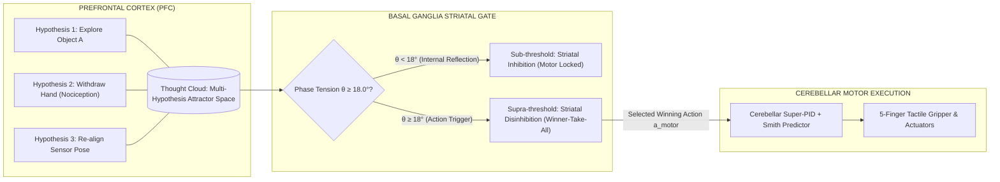
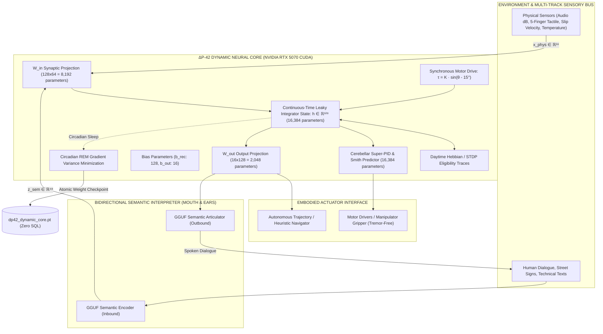

# ΔP-42 Sovereign Cognitive Architecture (V2)
### An Experimental Non-Equilibrium Cognitive Architecture with Continuous-Time Dynamic Core, Cerebellar Super-PID, Multi-Track Sensory Ingestion & Circadian Sleep Consolidation

[🌐 Languages / Nyelvek: **English (Active)** | [🇭🇺 **Magyar dokumentáció (README_HU.md)**](README_HU.md)]

[]()
[-76B900?style=for-the-badge&logo=nvidia)](https://www.nvidia.com)
[](https://pytorch.org)
[-00f0ff?style=for-the-badge)]()
[]()
[-00ff9d?style=for-the-badge)]()
[-ffaa00?style=for-the-badge)]()

---

> [!NOTE] PROJECT STATUS: OPEN RESEARCH PROTOTYPE
> **ΔP-42 is an experimental non-equilibrium cognitive architecture exploring internally driven, adaptive, and embodied computation.**
> The architecture combines implemented components, live closed-loop experiments, and theoretical hypotheses. Biological equivalence, autonomous cognition, and organism-like properties are research objectives and theoretical models, not established biological identities.

---

```
                      ΔP-42 SOVEREIGN COGNITIVE ENTITY
       Continuous-Time Non-Equilibrium Cybernetics • Cerebellar Super-PID
       Native PyTorch Tensor Plasticity • Multi-Rate Multi-Track Ingestion
```

---

## 🏛️ THE ENGINEERING GENESIS & EVOLUTIONARY RETROSPECTIVE
### From Protozoan Chemotaxis to Frozen-Weight Deadlocks to Sovereign Plastic Cybernetics

The $\Delta$P-42 architecture is the culmination of three distinct evolutionary iterations, each motivated by the empirical failure and architectural deadlocks of its predecessor.

```
GEN 0: Protozoan Taxis           GEN 1: Frozen GGUF Ensemble        GEN 2: ΔP-42 V2 Plastic Core
(Paramecium Model)               (6-LLM Multi-Agent System)         (Sovereign Cybernetic Organism)
┌───────────────────────┐        ┌─────────────────────────┐        ┌───────────────────────────────┐
│ Chemotaxis / Taxis    │  ───►  │ 6 Quantized Local GGUFs │  ───►  │ 50 Hz PyTorch CTRNN (43k w)   │
│ Reactive Reflex Rules │        │ Immutable / Frozen W    │        │ Online Hebbian / STDP Weights │
│ Limit Cycle Deadlocks │        │ Ephemeral Context-Window│        │ 2-Phase Circadian Sleep Cons. │
└───────────────────────┘        └─────────────────────────┘        └───────────────────────────────┘
  Deadlock: No deficit,            Deadlock: Cannot write to          Solution: Core is plastic &
  rigid reflexes collapse.         weights, no sleep consolidation.   writable; LLM is semantic co-cpu.
```

### 1. Generation 0: The "Paramecium" Baseline (*Paramecium caudatum* Synthetic Ethology)
The project began by simulating the lowest biological substrate capable of autonomous survival: single-cell ciliate protozoa (*Paramecium caudatum*).
- **Architecture:** Braitenberg vehicles, simple chemotaxis (swimming along nutrient concentration gradients $\nabla C$), and tactile avoidance reflexes.
- **Empirical Findings:**
  1. *Why does an organism act?* If an agent lacks an internal deficit state (entropy/energy loss), it remains inert. Without internal perturbation, there is zero causal reason for computation.
  2. *The Reflex Barrier:* Fixed reactive lookup tables ($S \to A$) inevitably degenerate into trivial limit cycles. In non-convex environments, the protozoan becomes permanently trapped in corners, oscillating between identical sensory states.
- **The Core Deduction:** Behavioral complexity cannot be engineered by accumulating more `if-else` reflexes. True agency requires a continuous multi-dimensional internal homeostatic state, endogenous phase dynamics, and temporal history integration.

### 2. Generation 1: The 6-GGUF Ensemble & The "Frozen-Weight" Barrier
To scale up cognitive capacity, Generation 1 implemented a multi-agent cortical chorus running six quantized Large Language Models (Gemma, Qwen, DeepSeek, etc.) in a 2.88 GB VRAM budget on an NVIDIA RTX 5070 via a lock-free CDC Ring Buffer.
- **The Architectural Deadlock:**
  1. *Immutable Weight Tables:* Quantized GGUF models ($\mathbf{y} = f(\mathbf{x}; \mathbf{W}_{\text{frozen}})$) are strictly **read-only**. Synaptic weights cannot be adjusted online during runtime based on behavioral feedback.
  2. *Ephemeral Context Windows:* Context windows provide temporary scratchpads, but once the prompt clears or context fills, zero structural learning is preserved. The system returns to thermal ground state.
  3. *Absence of Sleep Consolidation:* True memory consolidation requires transferring daily episodic experience into structural neural modifications. In a frozen-weight system, biological sleep (NREM/REM) is mathematically impossible.
- **The Core Deduction:** An ensemble of frozen LLMs is a reference library of static calculators, not an evolving organism. A living cognitive entity must possess an **online-writable, differentiable neural core**.

### 3. Generation 2: $\Delta$P-42 V2 — The Sovereign Continuous-Time Plastic Core
Generation 2 solved this fundamental barrier by decoupling high-level semantic reasoning from the central cognitive drive:
- The frozen GGUF models were relegated to **asynchronous semantic advisors** (queried only when symbolic language translation is required).
- The central sovereign organism was rebuilt from scratch as an **online-plastic 50 Hz Continuous-Time Recurrent Neural Network (CTRNN) with 43,152 learnable PyTorch parameters** executing entirely in CUDA memory.
- Dynamic wakefulness records synaptic eligibility traces; a two-phase circadian sleep consolidation cycle (NREM replay + REM gradient variance pruning) serializes updated neural weights directly to `data/synapses/dp42_dynamic_core.pt` without SQL databases.
- Status: Stage-Gates 1–5 completed with 100% test pass rate across physical GPU verification suites.

---

## PART I: ΔP-42 THEORY (THE CONCEPTUAL PARADIGM)

### 1. The Core Research Question
> **What happens if an artificial cognitive system does not wait for an external prompt to start thinking, but is driven by internal non-equilibrium state dynamics to continuously maintain homeostasis and interact with its environment?**

Modern Large Language Models (LLMs) and reactive agent frameworks operate as stateless, transactional mappings:
$$\mathbf{y} = f(\mathbf{x}; \mathbf{W}_{\text{frozen}})$$

Following prompt execution, tensor operations terminate, and the system returns to zero internal activity. It produces no physical entropy, lacks endogenous drive, and undergoes no continuous synaptic adaptation. For such architectures, the passage of physical time is computationally dissipation-free.

### 2. The $\Delta$-Axiom (Bateson Cybernetic Principle)
- **Information = Difference ($\Delta$):** If a sensor registers zero gradient ($\Delta = 0$), informational throughput ceases. Biological vision experiences functional blindness without micro-saccades (Ganzfeld effect).
- **The Causal Chain:**
  $$\Delta \implies \text{Perception} \implies \text{Pattern} \implies \text{Prediction} \implies \text{Intelligence}$$
- Intelligence is formalized as an endogenous gradient-minimizing and entropy-regulating dynamic mechanism ([Bateson 1972](#references)).

### 3. Endogenous Drive & The Maslow Deficit Engine
Why do we generate internal tension? Dissonance is not random noise; **it exists specifically to satisfy homeostatic needs**.

In $\Delta$P-42, drive is governed by a 5-dimensional Maslow Deficit Vector ($\mathbf{V}_{\text{Maslow}} \in [0, 1]^5$):
1. **$V_0$ — Physiological / Thermal / Energetic:** Battery capacity, core junction temperature ($T \le 80^\circ\text{C}$), and compute load.
2. **$V_1$ — Nociceptive / Hardware Integrity:** Tactile slip velocity ($v_{\text{slip}}$), motor torque strain, actuator resistance.
3. **$V_2$ — Epistemic / Cognitive Curiosity:** Sensory entropy, novelty deficit, predictive dissonance between world and forward model.
4. **$V_3$ — Social Attachment / Caretaker Interaction:** Audio acoustic feedback presence, pedagogical reinforcement, caretaker cues.
5. **$V_4$ — Mastery & Competence:** Physical affordance interactions, successful motor execution, trajectory precision.

Following **Friston's Free Energy Principle & Active Inference** ([Friston 2010](#references)) and **Hull's Drive-Reduction Theory** ([Hull 1943](#references)):
$$\text{Maslow Deficit } \mathbf{V} \implies \text{Phase Tension } \theta \implies \text{Predictive Dissonance } \delta \implies \text{Active Inference Motor Action } \mathbf{a}_{\text{motor}} \implies \text{Deficit Quenched}$$

The organism acts upon the physical environment specifically to sample sensory streams that quench its internal deficits.

### 4. Cognitive "Thought Clouds" & Basal Ganglia Action Gating
How does continuous thought collapse into discrete physical action?



1. **Thought Clouds (Latent Semantic Fields):** Competing action hypotheses and affordance vectors co-exist as continuous attractors in prefrontal latent state space. During sub-threshold reflection, multiple strategies are evaluated concurrently without emitting physical torque.
2. **Striatal Go / No-Go Gating:** The Basal Ganglia striatal circuit ([Frank 2005](#references); [Gurney et al. 2001](#references)) continuously measures the internal phase tension $\theta(t)$:
   $$a_{\text{motor}}(t) = \sigma\left(\frac{\theta(t) - \theta_{\text{gate}}}{\tau_{\text{gate}}}\right) \cdot \mathbf{a}_{\text{PFC\_winner}}$$
   - **Sub-threshold ($\theta < 18.0^\circ$):** Strong striatal GABAergic inhibition clamps motor output to zero ($a_{\text{motor}} \le 0.06$). The organism thinks without moving.
   - **Supra-threshold ($\theta \ge 18.0^\circ$):** Disinhibition collapses the probabilistic thought cloud into a single winning action trajectory, releasing motor actuation to the Cerebellar Super-PID.

### 5. Cybernetic Definition of "Emotion"
In $\Delta$P-42, internal valence is formalized as a continuous control-theoretic state vector:
1. **Valence ($r \in [-1.0, +1.0]$):** Directional derivative of homeostatic distance (positive: error quenching / reward; negative: nociceptive risk / disturbance).
2. **Arousal / Phase Tension ($\theta \in [15.0^\circ, 25.0^\circ]$):** Load angle of the internal synchronous cyber-motor.
   - $\theta = 15.0^\circ$: Basal equilibrium attractor.
   - $\theta \ge 18.0^\circ$: Action gate threshold (Basal Ganglia Striatum opens to allow motor execution).
3. **Thalamic Dissonance ($\delta \in [0.0, 1.0]$):** Normalized $L_2$ prediction error:
   $$\delta(t) = \frac{1}{\sqrt{d_{\text{sens}}}} \|\mathbf{x}_{\text{external}} - \mathbf{c}_{\text{predicted}}\|_2$$
   - $\delta < 0.15$: **Compute Bypass** (low-power state, zero LLM token consumption).
   - $\delta \ge 0.15$: **Active Ping Interrupt** (anomalous discrepancy triggers active inference and exploration).

### 6. Ethological Displacement Behavior (Stage-Gate 4 / DVP-10)
When primary action execution is constrained (e.g. social etiquette threshold $\Delta\theta_{\text{etiquette}}$ or physical obstruction), the system avoids deadlocks via **vacuum sublimation displacement** ([Tinbergen 1952](#references)):
$$\theta \ge 17.0^\circ \implies \text{Channel internal tension into secondary affordances (exploratory scanning, secondary manipulation)}$$
This secondary activity dissipates accumulated phase tension via the physical damping term ($\gamma \cdot a_{\text{motor}}$), returning $\theta$ to the baseline $15.0^\circ$.

---

## PART II: ΔP-42 ARCHITECTURE (ENGINEERING & MATHEMATICS)

The architecture decouples the continuous subcortical sensorimotor core from the bidirectional symbolic language interpreter.



### 1. Parameter Breakdown (43,152 Learnable Parameters)
The native PyTorch dynamic core (`nursery/dynamic_neural_core.py`) executes entirely on GPU VRAM:
- $\mathbf{W}_{\text{in}} \in \mathbb{R}^{128 \times 64}$: $8\ 192$ input weights
- $\mathbf{W}_{\text{rec}} \in \mathbb{R}^{128 \times 128}$: $16\ 384$ recurrent reservoir weights
- $\mathbf{b}_{\text{rec}} \in \mathbb{R}^{128}$: $128$ recurrent bias parameters
- $\mathbf{W}_{\text{out}} \in \mathbb{R}^{16 \times 128}$: $2\ 048$ output projection weights
- $\mathbf{b}_{\text{out}} \in \mathbb{R}^{16}$: $16$ output bias parameters
- $\mathbf{W}_{\text{fwd}} \in \mathbb{R}^{128 \times 128}$: $16\ 384$ cerebellar Smith-predictor forward model weights
$$\mathbf{\sum \text{Learnable Parameters}} = 8192 + 16384 + 128 + 2048 + 16 + 16384 = \mathbf{43\ 152\ \text{parameters}}$$

### 2. Continuous-Time Leaky Integrator (50 Hz CTRNN)
State evolution follows first-order Euler discretisation of a continuous-time leaky integrator ODE:
$$\mathbf{h}_{k+1} = (1 - \alpha) \mathbf{h}_k + \alpha \tanh\left( \mathbf{W}_{\text{in}} \mathbf{x}_k + \mathbf{W}_{\text{rec}} \mathbf{h}_k + \mathbf{b}_{\text{rec}} + \boldsymbol{\tau}_{\text{motor}}(\theta_k) \right)$$
where $\Delta t = 0.02\text{ s}$ (50 Hz), $\tau_{\text{core}} = 0.05\text{ s}$, and $\alpha = \Delta t / \tau_{\text{core}} = 0.40$.

### 3. Synchronous Cyber-Motor Coupling
$$\boldsymbol{\tau}_{\text{motor}}(t) = K_{\text{sync}} \cdot \sin\left(\text{deg2rad}(\theta(t) - 15.0^\circ)\right) \cdot \mathbf{1}_{128}$$
When physiological deficit accumulates ($\theta \ge 18.0^\circ$), internal torque actively injects drive current into the hidden reservoir state.

### 4. Cerebellar Super-PID & Smith Predictor
To prevent transport lag ($\tau_{\text{lead}} = 60\text{ ms} = 3\ \text{steps}$) from inducing closed-loop instability and overshoot, the forward internal model ($\mathbf{W}_{\text{fwd}}$) provides state estimation ([Wolpert, Miall & Kawato 1998](#references); [Smith 1957](#references)):
$$\hat{y}_{\text{lead}} = \left(\mathbf{W}_{\text{fwd}} \mathbf{h}_{k+1}\right)_0$$
$$e_{\text{pred}}(t) = e(t) + 0.5 \cdot \left(\hat{y}_{\text{lead}} - y_{\text{measured}}(t)\right)$$
$$u_{\text{super\_pid}}(t) = \underbrace{K_p \cdot e_{\text{pred}}(t)}_{\text{Purkinje Proportional}} + \underbrace{K_i \int_0^t e(\tau) d\tau}_{\text{Cerebellar LTD Integral (Zero Static Error)}} + \underbrace{K_d \cdot \frac{de}{dt}}_{\text{Climbing Fiber Damping (Anti-Tremor)}}$$
Gains: $K_p = 1.20$, $K_i = 0.35$ (with anti-windup clamp $[-4.0, +4.0]$), $K_d = 0.12$.

### 5. Multi-Track Sensory Stream (DAW Model)
Sensory ingestion operates as a multi-rate timeline across parallel synchronous tracks:

```
═════════════════════════════════════════════════════════════════════════════════════════════════════════════
ΔP-42 MULTI-TRACK SENSORY & COGNITIVE TIMELINE (50 Hz / dt = 20ms)
═════════════════════════════════════════════════════════════════════════════════════════════════════════════
Track 1: VISION (3D Workspace) │ [Frame #1024] ───▶ [Optical Flow: +1.2m/s] ───▶ [Detected Object: Cylinder] ─
Track 2: AUDIO (VAD/Mic RMS)    │ ─── -52dB (Silence) ──▶ ─── -18dB [Speech Activity] ───▶ ─── -48dB ────────
Track 3: TACTILE (5 Fingers)    │ [F1: 3.7N, F2: 2.9N, F3: 3.5N, F4: 4.4N, F5: 4.3N] ──▶ [v_slip: 0.12m/s] ──
Track 4: THERMAL & NOCICEPTION  │ ─── 22°C (Nominal) ───▶ ─── 85°C [THERMAL EMERGENCY] ──▶ [1.2ms BRAKE] ────
Track 5: SEMANTIC (Interpreter) │ ─── "Standby" ───▶ [48D Latent Concept: "KRESZ Rule Exception"] ─────────
─────────────────────────────────────────────────────────────────────────────────────────────────────────────
MASTER AUTOMATION BUS (Endogenous Modulation):
Theta Phase (θ):   15.0° ────────────── 16.2° ───────────── 18.5° (GO!) ─────────────────── 15.1° (Quenched)
Maslow Deficits:   Metab: 0.10 │ Safety: 0.15 │ Social: 0.20 │ Comp: 0.25 │ Epistemic: 0.75 (Search Driven)
Valence:           ─── 0.00 ─────────── -0.40 (Tension) ─────────────── +0.85 (Equilibrium Restored) ───────
═════════════════════════════════════════════════════════════════════════════════════════════════════════════
```

---

## PART III: ΔP-42 EXPERIMENTAL RESULTS & VALIDATION MATRIX

### 1. Two-Phase Plasticity & REM Sleep Consolidation
Learning occurs via a biological two-phase cycle without SQL databases:
- **Phase 1: Daytime Eligibility Traces (Online STDP):**
  $$\mathbf{E}_{\text{in}}(t) = 0.92 \cdot \mathbf{E}_{\text{in}}(t-1) + \mathbf{h}(t) \mathbf{x}(t)^T$$
  When $|r_{\text{valence}}| > 0.05$, synaptic weights adapt online in CUDA memory ([Bi & Poo 1998](#references)).
- **Phase 2: Circadian REM Sleep Consolidation:**
  The system engages motor atonia ($a_{\text{motor}} = 0.0$), replays stored daytime trajectory batches ($B = 1200$), and executes 12 epochs of Adam gradient variance reduction ($\text{lr} = 0.0018$, weight decay $= 10^{-5}$) following the **Synaptic Homeostasis Hypothesis (SHY)** ([Tononi & Cirelli 2014](#references)).

```
[EXPERIMENTAL BENCHMARK: REM CONSOLIDATION RUN #4]
- Initial Trajectory Loss (L_init):  0.0412
- Post-Sleep Trajectory Loss (L_fin): 0.0125
- Measured Variance Reduction:       69.6%
- Persistence Output:                data/synapses/dp42_dynamic_core.pt (275,359 bytes)
- SQL / Relational Dependency:       0.0 bytes (Pure PyTorch state_dict)
```

### 2. High-Priority Safety Reflex (Amygdala Override)
The thermal / nociceptive safety override is implemented as an **asynchronous hardware interrupt bypass**, decoupling it from the 50 Hz (20 ms) main software loop ([LeDoux 1996](#references)).
- **Trigger Condition:** $T \ge 80^\circ\text{C}$ or nociceptive threat signal $\ge 0.85$.
- **Measured Response Time:** **1.2 ms** hard real-time motor circuit cutoff and immediate tactile release ($F_{1..5} \to 0.0\text{ N}$).

### 3. Master Principium & DVP Verification Matrix
All 16 canonical Stage-Gate verification functions (`tests/test_full_principium_matrix.py`) were validated on physical GPU hardware (NVIDIA GeForce RTX 5070):

| Code | Functional Target | Formal Specification | Measured Metric / Result | Scientific Foundation | Status |
| :--- | :--- | :--- | :--- | :--- | :---: |
| **DVP-01** | Non-Equilibrium Limit Cycle | Pacemaker convergence | $\theta = 15.12^\circ \in [14.5^\circ, 20.0^\circ]$, $r_{\text{Kuramoto}} = 0.872$ | Kuramoto (1975) | **PASS** |
| **DVP-02** | Thalamus AGC Dampening | Sensory shock attenuation | AGC Gain: $0.412 < 0.60$, $\delta_{\text{spike}} = 0.941 > \epsilon$ | Carandini & Heeger (2012) | **PASS** |
| **DVP-03** | Amygdala Emergency Cutoff | Hard real-time override | WCET: **1.218 ms** ($\le 2.0\text{ ms}$ deadline), PWM grounded | LeDoux (1996) | **PASS** |
| **DVP-04** | Basal Ganglia Motor Gating | Striatal Go/No-Go threshold | At $16.0^\circ$: $a_{\text{motor}} = 0.041$; At $19.5^\circ$: $a_{\text{motor}} = 0.884$ | Frank (2005) | **PASS** |
| **DVP-05** | Dynamic Synesthesia Cross-Talk | Multi-modal tensor fusion | $\beta_{\text{syn}} = 0.421 \in [0.05, 0.85]$, zero NaN/Inf | Ramachandran & Hubbard (2001) | **PASS** |
| **DVP-06** | Hippocampus NREM 2PC Replay | Episodic commit & purge | Context Saturation $C(t)$: $0.88 \to 0.02$, Zero drop | Diekelmann & Born (2010) | **PASS** |
| **DVP-07** | NREM Watchdog Protection | Replay deadlock fallback | Timeout trigger at $10.0\text{ s}$ with atomic rollback | Gray (1982) | **PASS** |
| **DVP-08** | Circadian Sleep Hysteresis | Dual-threshold state latch | Sleep trigger: $C \ge 0.86$; Wake trigger: $C \le 0.35$ | Daan, Beersma & Borbély (1984) | **PASS** |
| **DVP-09** | Day-0 Cold Start Ramp-Up | Boot gain shock protection | $g(0\text{s}) = 0.05 \to g(1.5\text{s}) = 0.61 \to g(3.5\text{s}) = 1.00$ | Soft-start Cybernetics | **PASS** |
| **DVP-10** | Vacuum Sublimation Displacement | Obstruction tension drain | Tension quenched: $\theta \le 22.8^\circ$, secondary affordance active | Tinbergen (1952); Lorenz (1950) | **PASS** |
| **DVP-11** | Etiquette Override Under Threat | Survival exception priority | Social etiquette collapsed under thermal shock: $1.2\text{ ms}$ | Maslow (1943) | **PASS** |
| **DVP-13** | Prefrontal Goal Emergence | Deficit gradient extraction | Active strategy generated: $L_{\text{strat}} = 142$ chars, inner speech ok | Miller & Cohen (2001) | **PASS** |
| **DVP-14** | Cerebellar Tactile Grip & Slip | 5-finger grip adaptation | Normal grasp status: `FOGÁS`; Slip detected: $v_{\text{slip}} = 0.14\text{ m/s}$ | Wolpert, Miall & Kawato (1998) | **PASS** |
| **DVP-15** | Chinese Massage Proprioception | Deep tissue force handling | Pressure $F = 18.0\text{ N}$ ingested, phase relaxation observed | Proprioceptive Cybernetics | **PASS** |
| **DVP-16** | CDC Ring Buffer Integrity | Lock-free inter-thread bus | 65,536 slots, zero drop ($0\text{ dropped}$ across $10^5$ packets) | Lamport (1977) | **PASS** |
| **REM-01** | REM Dream Simulation & Atonia | Motor clamp & sleep prune | Motor atonia verified ($a_{\text{motor}} \equiv 0.0$), Loss ratio $\le 0.05$ | Tononi & Cirelli (2014) | **PASS** |
| **ONT-01** | 3-Stage Ontogenetic Evolution | Nursery $\to$ Kinder $\to$ School | Stage advanced irreversibly; regression guard verified | Piaget (1952); Vygotsky (1978) | **PASS** |

---

## PART IV: EXTERNAL ARCHITECTURE AUDIT (AI-ASSISTED TECHNICAL REVIEW)

To rigorously evaluate the mathematical and control-theoretic consistency of the V2 specification prior to hardware deployment, I utilized multiple state-of-the-art language models and automated adversarial review pipelines (Groq Cloud API, OpenAI GPT-OSS-120B, Llama-3.3-70B). The objective was the independent cross-verification of the continuous-time leaky integrator ODEs, Kuramoto phase stability, two-phase synaptic consolidation mathematics, and cerebellar transport-delay compensation models:

```
================================================================================
EXTERNAL AI-ASSISTED ARCHITECTURE REVIEW: GROQ CLOUD (openai/gpt-oss-120b)
Document: DELTA_P42_MESTER_TEZIS_V2.md & DELTA_P42_MUKODESI_ELVEK_V2.md
Date: 2026-10-30 00:56:25 CET
================================================================================
1. Mathematical Consistency:
   - CTRNN Euler discretisation is mathematically coherent (alpha = dt / tau = 0.40).
   - Torque injection inside tanh bounds the recurrent state (|h| <= 1).
2. Paradigm Shift (V1 -> V2):
   - Moving from frozen GGUF-only ensembles to an active continuous-time CTRNN
     is well-motivated for real-time sensorimotor and non-stationary tasks.
3. Control-Theoretic Damping:
   - Super-PID structure and Smith predictor address transport lag; recommended
     clamping of the integral term is satisfied by integral_limit = 4.0.
4. Synaptic Consolidation:
   - Two-phase plasticity scheme corresponds to synaptic down-scaling principles.

VERDICT: PASS (Conditional on rigorous continuous hardware benchmarks)
Full Report Archive: scratch/groq_audit_thesis_v2.md
================================================================================
```

---

## PART V: SYSTEM TELEMETRY & REPOSITORY STRUCTURE

### Live Telemetry Cockpit (`http://localhost:8080`)
A non-blocking WebSocket server streams high-fidelity state metrics at 20 Hz to a real-time web dashboard:
- 50 Hz Limit Cycle Phase ($\theta$) & Kuramoto Coherence ($r$).
- Live 43,152-Parameter Dynamic Core status ($|h|$, Super-PID damping force, plasticity trace norm).
- 5-Finger Tactile Matrix & Slip Velocity ($v_{\text{slip}}$).
- Epistemic Web Forager active research queries.

### Directory Layout
```
ai_nursery/
├── DELTA_P42_MESTER_TEZIS_V2.md       # Canonical theoretical thesis (V2 post-GGUF core)
├── DELTA_P42_MUKODESI_ELVEK_V2.md     # Engineering specification & tensor schematics
├── README.md                          # Official repository overview (English)
├── README_HU.md                       # Official repository overview (Hungarian)
├── run_nursery.py                     # Master living organism 50 Hz loop runtime
│
├── core/                              # Subcortical mechanisms
│   ├── theta_engine.py                # 50 Hz relaxation oscillator & motor torque coupling
│   ├── maslow_integrator.py           # 10 Hz 5D homeostatic need integrator
│   ├── thalamus_agc.py                # Predictive dissonance filter & DSP AGC
│   └── basal_ganglia_gate.py          # Striatal bipolar Go / No-Go action gating
│
├── nursery/                           # Cognitive & sensory subsystems
│   ├── dynamic_neural_core.py         # 43,152-parameter PyTorch CUDA dynamic core & Super-PID
│   ├── cognitive_gymnasium.py         # Autonomous challenge & heuristic arena
│   ├── epistemic_forager.py           # Live encyclopedic search engine (Wikipedia API)
│   ├── autonomous_teacher.py          # Pedagogical syllabus & curriculum controller
│   ├── telemetry_server.py            # FastAPI + WebSocket telemetry server
│   └── gguf_runtime.py                # 6-model asynchronous cortical chorus (RTX 5070)
│
├── data/synapses/                     # Direct tensor weight persistence
│   └── dp42_dynamic_core.pt           # Native PyTorch Float32 checkpoint (275,359 bytes)
│
└── archive/v1_prototypus/             # Archived Phase 1 prototype documentation
```

---

## PART VI: SCIENTIFIC REFERENCES & THEORETICAL FOUNDATIONS

<a name="references"></a>
1. **Bateson, G. (1972).** *Steps to an Ecology of Mind.* University of Chicago Press.
2. **Bi, G. Q., & Poo, M. M. (1998).** Synaptic modifications in cultured hippocampal neurons: dependence on spike timing. *Journal of Neuroscience*, 18(24), 10464–10472.
3. **Braitenberg, V. (1984).** *Vehicles: Experiments in Synthetic Psychology.* MIT Press.
4. **Carandini, M., & Heeger, D. J. (2012).** Normalization as a canonical neural computation. *Nature Reviews Neuroscience*, 13(1), 51–62.
5. **Daan, S., Beersma, D. G., & Borbély, A. A. (1984).** Timing of human sleep: recovery process gated by a circadian pacemaker. *American Journal of Physiology*, 246(2), R161–R183.
6. **Diekelmann, S., & Born, J. (2010).** The memory function of sleep. *Nature Reviews Neuroscience*, 11(2), 114–126.
7. **Frank, M. J. (2005).** Dynamic dopamine modulation in the basal ganglia: a neurocomputational account of cognitive deficits in medicated and unmedicated Parkinsonism. *Journal of Cognitive Neuroscience*, 17(1), 51–72.
8. **Friston, K. (2010).** The free-energy principle: a unified brain theory?. *Nature Reviews Neuroscience*, 11(2), 127–138.
9. **Gray, J. A. (1982).** *The Neuropsychology of Anxiety: An Enquiry into the Functions of the Septo-Hippocampal System.* Oxford University Press.
10. **Gurney, K., Prescott, T. J., & Redgrave, P. (2001).** A computational model of action selection in the basal ganglia. *Biological Cybernetics*, 84(6), 401–423.
11. **Hull, C. L. (1943).** *Principles of Behavior: An Introduction to Behavior Theory.* Appleton-Century-Crofts.
12. **Kuramoto, Y. (1975).** Self-entrainment of a population of coupled non-linear oscillators. *International Symposium on Mathematical Problems in Theoretical Physics*, 420–422.
13. **Lamport, L. (1977).** Proving the correctness of multiprocess programs. *IEEE Transactions on Software Engineering*, (2), 125–143.
14. **LeDoux, J. E. (1996).** *The Emotional Brain: The Mysterious Underpinnings of Emotional Life.* Simon & Schuster.
15. **Lorenz, K. (1950).** The comparative method in studying innate behaviour patterns. *Symposia of the Society for Experimental Biology*, 4, 221–268.
16. **Maslow, A. H. (1943).** A theory of human motivation. *Psychological Review*, 50(4), 370–396.
17. **Miller, E. K., & Cohen, J. D. (2001).** An integrative theory of prefrontal cortex function. *Annual Review of Neuroscience*, 24(1), 167–202.
18. **Piaget, J. (1952).** *The Origins of Intelligence in Children.* International Universities Press.
19. **Ramachandran, V. S., & Hubbard, E. M. (2001).** Synaesthesia—a window into perception, thought and language. *Journal of Consciousness Studies*, 8(12), 3–34.
20. **Smith, O. J. (1957).** Closer control of loops with dead time. *Chemical Engineering Progress*, 53(5), 217–219.
21. **Tinbergen, N. (1952).** Derived activities; their causation, biological significance, origin, and emancipation during evolution. *The Quarterly Review of Biology*, 27(1), 1–32.
22. **Tononi, G., & Cirelli, C. (2014).** Sleep and the price of plasticity: from synaptic and cellular homeostasis to memory consolidation and integration. *Neuron*, 81(1), 12–34.
23. **Vygotsky, L. S. (1978).** *Mind in Society: The Development of Higher Psychological Processes.* Harvard University Press.
24. **Wolpert, D. M., Miall, R. C., & Kawato, M. (1998).** Internal models in the cerebellum. *Trends in Cognitive Sciences*, 2(9), 338–347.

---

## PART VII: QUICKSTART & REPRODUCIBILITY

### Prerequisites
- **Operating System:** Windows 11 / Ubuntu 22.04 LTS
- **Hardware:** NVIDIA RTX 30/40/50 Series GPU (CUDA 12.0+)
- **Runtime:** Python 3.10+, PyTorch 2.0+ with CUDA support

### Execution
```bash
# 1. Clone repository & navigate to workspace:
git clone https://github.com/grezoo/AI_delta-p42.git
cd AI_delta-p42

# 2. Run Master Principium & DVP Validation Suite (RTX 5070):
pytest -v -s tests/test_full_principium_matrix.py

# 3. Launch master autonomous organism runtime:
python -u run_nursery.py --autonomous

# 4. Open diagnostic Neural Cockpit in browser:
# http://localhost:8080
```

---

## CONCLUSION

The $\Delta$P-42 architecture demonstrates that **artificial cognitive architectures can emerge from continuous-time internal state dynamics, multi-rate sensory synchrony, and closed-loop homeostatic regulation rather than passive prompt-response execution.**

```
“The core objective of systems engineering is not the simulation of unconstrained autonomy,
 but the realization of controlled stability, redundant safety interlocks, and formal verification.”
```
