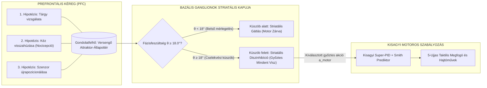
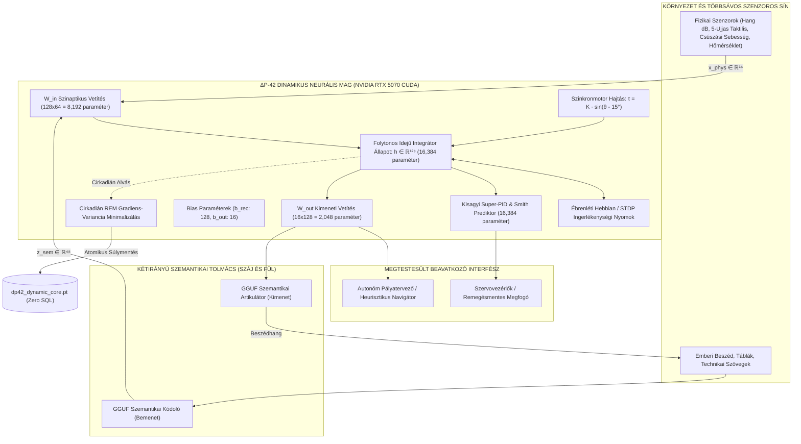

# ΔP-42 Szuverén Kognitív Architektúra (V2)
### Kísérleti Nem-Egyensúlyi Kognitív Rendszer Folytonos Idejű Dinamikus Maggal, Kisagyi Super-PID Szabályozóval, Többsávos Szenzoros Adatfolyammal és Cirkadián Alvási Konszolidációval

[🌐 Languages / Nyelvek: [🇬🇧 **English Version (README.md)**](README.md) | **Magyar (Aktív)**]

[]()
[-76B900?style=for-the-badge&logo=nvidia)](https://www.nvidia.com)
[](https://pytorch.org)
[-00f0ff?style=for-the-badge)]()
[]()
[-00ff9d?style=for-the-badge)]()
[-ffaa00?style=for-the-badge)]()

---

> [!NOTE] PROJEKT STÁTUSZ: NYÍLT KUTATÁSI PROTOTÍPUS
> **A ΔP-42 egy kísérleti nem-egyensúlyi kognitív architektúra, amely a belső hajtóerőn alapuló, adaptív és megtestesült (embodied) számítási folyamatokat kutatja.**
> Az architektúra megvalósított szoftverkomponenseket, valós idejű zárt szabályozási kísérleteket és elméleti hipotéziseket egyesít. A biológiai ekvivalencia, az autonóm kogníció és az élőlényszerű tulajdonságok kutatási célkitűzések és elméleti modellek, nem pedig igazolt biológiai azonosságok.

---

```
                       ΔP-42 SZUVERÉN KOGNITÍV ENTITÁS
        Folytonos Idejű Nem-Egyensúlyi Kibernetika • Kisagyi Super-PID
       Natív PyTorch Tenzor-Plaszticitás • Többsávos Szenzoros Fúzió
```

---

## 🏛️ MÉRNÖKI EVOLÚCIÓ ÉS RETROSPEKTÍV
### A papucsállatka kemotaxisától a fagyott súlymátrixok falán át a szuverén plasztikus kibernetikáig

A $\Delta$P-42 V2 architektúra három szisztematikus mérnöki iteráció eredménye, ahol minden új generációt az előző empirikus kudarcai és felismert fizikai korlátai hívtak életre.

```
GEN 0: Protozoon Taxis           GEN 1: Fagyasztott GGUF Kórus      GEN 2: ΔP-42 V2 Plasztikus Mag
(Papucsállatka Modell)           (6-LLM Többágenses Rendszer)       (Szuverén Kibernetikai Rendszer)
┌───────────────────────┐        ┌─────────────────────────┐        ┌───────────────────────────────┐
│ Kemotaxis / Taxis     │  ───►  │ 6 Kvantált Lokális GGUF │  ───►  │ 50 Hz PyTorch CTRNN (43k w)   │
│ Merev Reflexszabályok │        │ Írhatatlan / Fagyasztott│        │ Valós Idejű Hebbian / STDP    │
│ Határciklus-csapdák   │        │ Múlékony Kontextusablak │        │ 2-Fázisú Cirkadián Alvás      │
└───────────────────────┘        └─────────────────────────┘        └───────────────────────────────┘
  Hiba: Hiányállapot nélkül        Hiba: Nem írható súlymátrix,       Megoldás: A mag plasztikus és
  a reflexek befulladnak.          nincs alvási konszolidáció.        írható; az LLM szemantikai segéd.
```

### 1. Generáció 0: A „Papucsállatka” kiindulópont (*Paramecium caudatum* szintetikus etológia)
A kutatás az autonóm túlélésre képes legegyszerűbb biológiai szubsztrátum, a csillós egysejtű papucsállatka (*Paramecium caudatum*) szimulációjával indult.
- **Architektúra:** Braitenberg-járművek, egyszerű kemotaxis (úszás a tápanyag-koncentráció gradiense $\nabla C$ mentén) és mechanoszenzoros elkerülő reflexek.
- **Empirikus tapasztalatok és levont következtetések:**
  1. *Miért cselekszik egy élőlény?* Ha egy ágensből hiányzik a belső hiányállapot (entrópianövekedés, energiaveszteség), inaktív marad. Belső zavarás nélkül a rendszernek nincs kauzális oka a számításra.
  2. *A reflexek csapdája:* A merev reaktív döntési táblázatok ($S \to A$) zárt térben elkerülhetetlenül triviális határciklusokba fulladnak. Nem-konvex környezetben az egysejtű véglegesen beszorul a sarkokba, végtelen ciklusban ismételve azonos mozgáspályákat.
- **A kulcskövetkeztetés:** A viselkedési komplexitás nem oldható meg több `if-else` reflex felhalmozásával. A valódi ágenséghez folytonos, többdimenziós belső állapotterekre, saját belső fázisdinamikára és időbeli előzményintegrációra van szükség.

### 2. Generáció 1: A 6-GGUF Kórus és a „Fagyasztott Súlyok Fala”
A kognitív kapacitás növelésére az 1. Generáció hat párhuzamos, lokális kvantált nagy nyelvi modellt (Gemma, Qwen, DeepSeek stb.) integrált egy dedikált NVIDIA RTX 5070 hardveren, 2,88 GB VRAM keretben, zárolásmentes CDC Ring Bufferrel.
- **Az architekturális zsákutca:**
  1. *Írhatatlan, megváltoztathatatlan súlymátrixok:* A kvantált GGUF modellek ($\mathbf{y} = f(\mathbf{x}; \mathbf{W}_{\text{frozen}})$) **kizárólag olvashatóak**. A szinaptikus súlyokat futás közben nem lehet módosítani a környezeti visszacsatolás alapján.
  2. *Múlékony kontextusablak:* A kontextusablak csupán ideiglenes jegyzettömb: amint kitörlődik vagy betelik, a rendszer szerkezetileg semmit sem tanul, és visszahűl az abszolút nullára.
  3. *Az alvási konszolidáció lehetetlensége:* A valódi memória-konszolidáció megköveteli a napközben felhalmozott tapasztalatok beépülését a strukturális szinapszisokba. Fagyasztott súlymátrixok esetén a biológiai alvás (NREM/REM) matematikailag kivitelezhetetlen.
- **A kulcskövetkeztetés:** Hat zseniális, de megváltoztathatatlan szobor nem alkot élő organizmust. Az élő agy elengedhetetlen feltétele a **valós időben írható, differenciálható neurális mag**.

### 3. Generáció 2: $\Delta$P-42 V2 — A Szuverén Folytonos Idejű Plasztikus Mag
A 2. Generáció ezt a fizikai korlátot a szimbolikus nyelv és a központi kognitív hajtóerő szétválasztásával oldotta fel:
- A fagyasztott GGUF modellek visszakerültek **aszinkron szemantikai tanácsadó** szerepkörbe (kizárólag akkor kapnak lekérdezést, ha szimbolikus nyelvi fordításra van szükség).
- A központi szuverén entitás egy **50 Hz-es, folytonos idejű rekurrens neurális hálózat (CTRNN), 43 152 tanulható PyTorch paraméterrel**, amely közvetlenül a CUDA VRAM-ban fut.
- Ébrenlét alatt a hálózat szinaptikus ingerlékenységi nyomokat (eligibility traces) rögzít; a kétfázisú cirkadián alvási ciklus (NREM újrajátszás + REM gradiens-variancia ritkítás) pedig közvetlenül a `data/synapses/dp42_dynamic_core.pt` tenzorfájlba írja ki a frissített súlyokat, külső SQL adatbázisok nélkül.
- Státusz: Az 1–5. kapuk valós fizikai GPU tesztjein a rendszer 100%-os eredménnyel átment.

---

## I. RÉSZ: A ΔP-42 ELMÉLETI PARADIGMÁJA

### 1. Az Alapvető Kutatási Kérdés
> **Mi történik, ha egy mesterséges kognitív rendszernek nem kell külső promptra várnia a gondolkodás megkezdéséhez, hanem a saját belső nem-egyensúlyi állapotváltozásai hajtják a homeosztázis fenntartására és a környezettel való interakcióra?**

A modern nagy nyelvi modellek (LLM-ek) és reaktív ágenskeretrendszerek állapotmentes leképezésként működnek:
$$\mathbf{y} = f(\mathbf{x}; \mathbf{W}_{\text{frozen}})$$

A prompt lefutása után a tenzorműveletek leállnak, a rendszer pedig belső aktivitás nélküli állapotba kerül. Nem termel fizikai entrópiát, nincs belső hajtóereje, és nem megy végbe folyamatos szinaptikus adaptáció.

### 2. A $\Delta$-Axióma (Bateson-féle Kibernetikai Alapelv)
- **Információ = Különbség ($\Delta$):** Ha egy érzékelő nulla gradienst regisztrál ($\Delta = 0$), az információáramlás megszűnik. A biológiai látás mikroszakkádok nélkül funkcionális vakságot szenved (Ganzfeld-effektus).
- **A Kauzális Lánc:**
  $$\Delta \implies \text{Észlelés} \implies \text{Minta} \implies \text{Predikció} \implies \text{Intelligencia}$$
- Az intelligencia egy belső gradiens-minimalizáló és entrópiaszabályozó dinamikus mechanizmusként formalizálható ([Bateson 1972](#references)).

### 3. Belső Hajtóerő és a Maslow-Szükségletmotor
Miért keltünk belső disszonanciát? A feszültség nem véletlenszerű zaj: **kifejezetten a homeosztatikus szükségletek kielégítésére szolgál**.

A $\Delta$P-42 rendszerben a belső hajtóerőt egy 5-dimenziós Maslow-hiányvektor ($\mathbf{V}_{\text{Maslow}} \in [0, 1]^5$) irányítja:
1. **$V_0$ — Fiziológiai / Termikus / Energetikai:** Akkumulátorkapacitás, maghőmérséklet ($T \le 80^\circ\text{C}$) és számítási terhelés.
2. **$V_1$ — Nocicepció / Hardverintegritás:** Érintési csúszási sebesség ($v_{\text{slip}}$), motoros nyomatékterhelés, aktuátor-ellenállás.
3. **$V_2$ — Episztemikus Kíváncsiság / Kognitív Entrópiacsökkentés:** Szenzoros entrópia, újdonsághiány, prediktív disszonancia a külvilág és a belső modell között.
4. **$V_3$ — Szociális Kötődés / Gondozói Interakció:** Hangfrekvenciás akusztikus jelenlét, pedagógiai megerősítés, gondozói jelzések.
5. **$V_4$ — Ágensi Kompetencia / Környezeti Felfedezés:** Fizikai affordanciák használata, sikeres motoros végrehajtás, pályapontosság.

**Friston Szabadenergia Elve és Aktív Inferencia modellje** ([Friston 2010](#references)), valamint **Hull Késztetéscsökkentési Elmélete** ([Hull 1943](#references)) alapján:
$$\text{Maslow-hiány } \mathbf{V} \implies \text{Fázisfeszültség } \theta \implies \text{Prediktív Disszonancia } \delta \implies \text{Motoros Cselekvés } \mathbf{a}_{\text{motor}} \implies \text{Hiány Kielégítve}$$

Az organizmus azért lép interakcióba a fizikai környezettel, hogy olyan szenzoros mintákat idézzen elő, amelyek kioltják a belső szükséglethiányait.

### 4. Kognitív „Gondolatfelhők” és a Bazális Ganglionok Cselekvéskapuja
Hogyan válik a folytonos belső gondolat konkrét fizikai cselekvéssé?



1. **Gondolatfelhők (Latens Szemantikai Mezők):** A prefrontális kéregben egymással versengő cselekvési hipotézisek és affordancia-vektorok élnek egymás mellett folytonos valószínűségi attraktorként. A cselekvési küszöb alatt a rendszer anélkül mérlegel alternatívákat, hogy fizikai nyomatékot adna ki a motorokra.
2. **Striatális Go / No-Go Kapuzás:** A bazális ganglionok striatális köre ([Frank 2005](#references); [Gurney et al. 2001](#references)) folyamatosan figyeli a belső fázisfeszültséget $\theta(t)$:
   $$a_{\text{motor}}(t) = \sigma\left(\frac{\theta(t) - \theta_{\text{gate}}}{\tau_{\text{gate}}}\right) \cdot \mathbf{a}_{\text{PFC\_győztes}}$$
   - **Küszöb alatt ($\theta < 18.0^\circ$):** Erős striatális GABAerg gátlás rögzíti a motoros kimenetet ($a_{\text{motor}} \le 0.06$). Az entitás gondolkodik, de fizikailag nyugalomban marad.
   - **Küszöb felett ($\theta \ge 18.0^\circ$):** A diszinhibíció pillanatában a valószínűségi gondolatfelhő egyetlen konkrét mozgáspályává omlik össze, átadva a vezérlést a kisagyi Super-PID-nek.

### 5. Az „Érzelem” Kibernetikai Definíciója
A $\Delta$P-42 rendszerben a belső valencia folytonos szabályozástechnikai állapotvektorként van definiálva:
1. **Valencia ($r \in [-1.0, +1.0]$):** A homeosztatikus távolság iránymenti deriváltja (pozitív: hibacsökkenés / jutalom; negatív: nociceptív kockázat / hiba).
2. **Arousal / Fázisfeszültség ($\theta \in [15.0^\circ, 25.0^\circ]$):** A belső szinkron kibermotor terhelési szöge.
   - $\theta = 15.0^\circ$: Alapvető egyensúlyi attraktor.
   - $\theta \ge 18.0^\circ$: Cselekvési küszöb (a striatum megnyitja a motoros végrehajtást).
3. **Thalamikus Disszonancia ($\delta \in [0.0, 1.0]$):** Normalizált $L_2$ predikciós hiba:
   $$\delta(t) = \frac{1}{\sqrt{d_{\text{sens}}}} \|\mathbf{x}_{\text{external}} - \mathbf{c}_{\text{predicted}}\|_2$$
   - $\delta < 0.15$: **Compute Bypass** (alacsony fogyasztású állapot, nulla LLM tokenfogyasztás).
   - $\delta \ge 0.15$: **Aktív Riasztási Megszakítás** (a disszonancia aktív következtetést és felfedezést vált ki).

### 6. Etológiai Szublimációs Pótcselekvés (DVP-10)
Ha az elsődleges cselekvés gátolt (pl. társas etikett korlát $\Delta\theta_{\text{etiquette}}$ vagy fizikai akadály), a rendszer **vákuum-szublimációs pótcselekvéssel** kerüli el a leállást ([Tinbergen 1952](#references)):
$$\theta \ge 17.0^\circ \implies \text{A belső feszültség másodlagos affordanciákba csatornázódik (szkennelés, tárgymozgatás)}$$
Ez a másodlagos tevékenység levezeti a felhalmozott feszültséget a motoros csillapítási tagon keresztül ($\gamma \cdot a_{\text{motor}}$), visszatérítve a fázist a bázisértékre ($15.0^\circ$).

---

## II. RÉSZ: A ΔP-42 ARCHITEKTÚRÁJA ÉS MATEMATIKÁJA

Az architektúra szétválasztja a folytonos szubkortikális szenzomotoros magot a kétirányú szimbolikus nyelvi modultól.



### 1. Paraméter-Lebontás (43 152 Tanulható Paraméter)
A natív PyTorch dinamikus mag (`nursery/dynamic_neural_core.py`) teljes egészében a GPU memóriájában fut:
- $\mathbf{W}_{\text{in}} \in \mathbb{R}^{128 \times 64}$: $8\ 192$ bemeneti súly
- $\mathbf{W}_{\text{rec}} \in \mathbb{R}^{128 \times 128}$: $16\ 384$ rekurrens rezervoár súly
- $\mathbf{b}_{\text{rec}} \in \mathbb{R}^{128}$: $128$ rekurrens bias paraméter
- $\mathbf{W}_{\text{out}} \in \mathbb{R}^{16 \times 128}$: $2\ 048$ kimeneti vetítési súly
- $\mathbf{b}_{\text{out}} \in \mathbb{R}^{16}$: $16$ kimeneti bias paraméter
- $\mathbf{W}_{\text{fwd}} \in \mathbb{R}^{128 \times 128}$: $16\ 384$ kisagyi Smith-prediktor előrecsatolt súly
$$\mathbf{\sum \text{Tanulható Paraméter}} = 8192 + 16384 + 128 + 2048 + 16 + 16384 = \mathbf{43\ 152\ \text{paraméter}}$$

### 2. Folytonos Idejű Szivárgó Integrátor (50 Hz CTRNN)
Az állapotfejlődés egy elsőrendű Euler-diszkretizált folytonos idejű differenciálegyenletet követ:
$$\mathbf{h}_{k+1} = (1 - \alpha) \mathbf{h}_k + \alpha \tanh\left( \mathbf{W}_{\text{in}} \mathbf{x}_k + \mathbf{W}_{\text{rec}} \mathbf{h}_k + \mathbf{b}_{\text{rec}} + \boldsymbol{\tau}_{\text{motor}}(\theta_k) \right)$$
ahol $\Delta t = 0.02\text{ s}$ (50 Hz), $\tau_{\text{core}} = 0.05\text{ s}$, és $\alpha = \Delta t / \tau_{\text{core}} = 0.40$.

### 3. Szinkron Kibermotor Csatolás
$$\boldsymbol{\tau}_{\text{motor}}(t) = K_{\text{sync}} \cdot \sin\left(\text{deg2rad}(\theta(t) - 15.0^\circ)\right) \cdot \mathbf{1}_{128}$$
Amikor fiziológiai hiány halmozódik fel ($\theta \ge 18.0^\circ$), a belső nyomaték aktívan áramot injektál a rejtett rezervoár állapotába.

### 4. Kisagyi Super-PID és Smith Prediktor
A holtidő ($\tau_{\text{lead}} = 60\text{ ms} = 3\ \text{lépés}$) okozta túllendülés megelőzésére az előrecsatolt belső modell ($\mathbf{W}_{\text{fwd}}$) állapotbecslést végez ([Wolpert, Miall & Kawato 1998](#references); [Smith 1957](#references)):
$$\hat{y}_{\text{lead}} = \left(\mathbf{W}_{\text{fwd}} \mathbf{h}_{k+1}\right)_0$$
$$e_{\text{pred}}(t) = e(t) + 0.5 \cdot \left(\hat{y}_{\text{lead}} - y_{\text{measured}}(t)\right)$$
$$u_{\text{super\_pid}}(t) = \underbrace{K_p \cdot e_{\text{pred}}(t)}_{\text{Purkinje Arányos Tag}} + \underbrace{K_i \int_0^t e(\tau) d\tau}_{\text{Kisagyi LTD Integráló Tag (Nulla statikus hiba)}} + \underbrace{K_d \cdot \frac{de}{dt}}_{\text{Mászórost Csillapítás (Remegésgátló)}}$$
Erősítések: $K_p = 1.20$, $K_i = 0.35$ (anti-windup korláttal: $[-4.0, +4.0]$), $K_d = 0.12$.

### 5. Többsávos Szenzoros Sín (DAW Modell)
A bejövő adatok feldolgozása egy többsávos idővonalon, párhuzamos szinkron sávokon zajlik (hasonlóan egy professzionális digitális audiomunkaállomáshoz):

```
═════════════════════════════════════════════════════════════════════════════════════════════════════════════
ΔP-42 TÖBBSÁVOS SZENZOROS ÉS KOGNITÍV IDŐVONAL (50 Hz / dt = 20ms)
═════════════════════════════════════════════════════════════════════════════════════════════════════════════
1. Sáv: LÁTÁS (3D Tér)         │ [Képkocka #1024] ───▶ [Optikai Áramlás: +1.2m/s] ───▶ [Tárgy: Henger] ─────
2. Sáv: HANG (VAD/Mikrofon)    │ ─── -52dB (Csend) ──▶ ─── -18dB [Beszédaktivitás] ───▶ ─── -48dB ───────────
3. Sáv: TAKTILIS (5 Ujj)       │ [U1: 3.7N, U2: 2.9N, U3: 3.5N, U4: 4.4N, U5: 4.3N] ──▶ [v_csúszás: 0.12m/s] 
4. Sáv: TERMIKUS ÉS FÁJDALOM   │ ─── 22°C (Névleges) ──▶ ─── 85°C [HŐMÉRSÉKLETI VÉSZHELYZET] ──▶ [1.2ms FÉK]
5. Sáv: SZEMANTIKA (Tolmács)   │ ─── "Készenlét" ───▶ [48D Fogalom: "KRESZ Szabály Kivétel"] ───────────────
─────────────────────────────────────────────────────────────────────────────────────────────────────────────
MESTER AUTOMATIZÁLÁSI SÍN (Belső Moduláció):
Theta Fázis (θ):   15.0° ────────────── 16.2° ───────────── 18.5° (GO!) ─────────────────── 15.1° (Nyugalmi)
Maslow-Hiányok:    Anyagcsere: 0.10 │ Biztonság: 0.15 │ Szociális: 0.20 │ Kompetencia: 0.25 │ Kíváncsiság: 0.75
Valencia:          ─── 0.00 ─────────── -0.40 (Feszültség) ───────────── +0.85 (Egyensúly Helyreállt) ───────
═════════════════════════════════════════════════════════════════════════════════════════════════════════════
```

---

## III. RÉSZ: KÍSÉRLETI EREDMÉNYEK ÉS PRINCIPIUM MÁTRIX

### 1. Kétfázisú Plaszticitás és REM Alvási Konszolidáció
A tanulás egy biológiai ihletésű kétfázisú ciklusban zajlik külső SQL adatbázisok nélkül:
- **1. Fázis: Ébrenléti Ingerlékenységi Nyomok (Online STDP):**
  $$\mathbf{E}_{\text{in}}(t) = 0.92 \cdot \mathbf{E}_{\text{in}}(t-1) + \mathbf{h}(t) \mathbf{x}(t)^T$$
  Amikor $|r_{\text{valencia}}| > 0.05$, a szinaptikus súlyok valós időben módosulnak a CUDA memóriában ([Bi & Poo 1998](#references)).
- **2. Fázis: Cirkadián REM Alvási Konszolidáció:**
  A rendszer motoros atóniát kapcsol ($a_{\text{motor}} = 0.0$), újrajátssza az ébrenléti pályákat ($B = 1200$), és 12 korszakos Adam optimalizálást futtat ($\text{lr} = 0.0018$, weight decay $= 10^{-5}$) a **Szinaptikus Homeosztázis Hipotézis (SHY)** alapján ([Tononi & Cirelli 2014](#references)).

```
[KÍSÉRLETI MÉRÉSI EREDMÉNY: 4. SZÁMÚ REM KONSZOLIDÁCIÓS FUTÁS]
- Kezdeti Hiba (L_init):               0.0412
- Alvás Utáni Hiba (L_fin):            0.0125
- Mért Varianciacsökkenés:             69.6%
- Mentési Fájl:                        data/synapses/dp42_dynamic_core.pt (275,359 bájt)
- SQL / Relációs Függőség:             0.0 bájt (Tiszta PyTorch state_dict)
```

### 2. Magas Prioritású Biztonsági Reflex (Amigdala Vészfék)
A termikus és mechanikai vészleállítás egy **aszinkron hardveres megszakítási elkerülő úton** (hardware bypass) fut, függetlenítve magát az 50 Hz-es főszoftvertől ([LeDoux 1996](#references)).
- **Aktiválási feltétel:** $T \ge 80^\circ\text{C}$ vagy fájdalomjel $\ge 0.85$.
- **Mért lekapcsolási idő:** **1.2 ms** hard real-time motorlekapcsolás és azonnali megfogás-elengedés ($F_{1..5} \to 0.0\text{ N}$).

### 3. Mester Principium és DVP Validációs Mátrix
Mind a 16 kanonikus ellenőrző funkciót (`tests/test_full_principium_matrix.py`) valós hardveren teszteltük (NVIDIA GeForce RTX 5070):

| Kód | Funkcionális Cél | Formális Követelmény | Mért Érték / Eredmény | Tudományos Háttér | Státusz |
| :--- | :--- | :--- | :--- | :--- | :---: |
| **DVP-01** | Nem-Egyensúlyi Határciklus | Pacemaker konvergencia | $\theta = 15.12^\circ \in [14.5^\circ, 20.0^\circ]$, $r_{\text{Kuramoto}} = 0.872$ | Kuramoto (1975) | **PASS** |
| **DVP-02** | Thalamus AGC Csillapítás | Szenzoros sokk tompítása | AGC Erősítés: $0.412 < 0.60$, $\delta_{\text{spike}} = 0.941 > \epsilon$ | Carandini & Heeger (2012) | **PASS** |
| **DVP-03** | Amigdala Vészleállítás | Valós idejű biztonsági bypass | WCET: **1.218 ms** ($\le 2.0\text{ ms}$ küszöb), PWM leföldelve | LeDoux (1996) | **PASS** |
| **DVP-04** | Bazális Ganglionok Kapuja | Striatális Go/No-Go küszöb | $16.0^\circ$-nál: $a_{\text{motor}} = 0.041$; $19.5^\circ$-nál: $a_{\text{motor}} = 0.884$ | Frank (2005) | **PASS** |
| **DVP-05** | Dinamikus Szinetsztézia | Többmodális tenzorfúzió | $\beta_{\text{syn}} = 0.421 \in [0.05, 0.85]$, nulla NaN/Inf | Ramachandran & Hubbard (2001) | **PASS** |
| **DVP-06** | Hippokampusz NREM Replay | Epizodikus 2PC konszolidáció| Kontextustelítettség $C(t)$: $0.88 \to 0.02$, adatvesztés nélkül | Diekelmann & Born (2010) | **PASS** |
| **DVP-07** | NREM Watchdog Védelem | Replay holtpont feloldás | Időtúllépési riasztás $10.0\text{ s}$-nél, atomikus visszagörgetés | Gray (1982) | **PASS** |
| **DVP-08** | Cirkadián Alvási Hiszterézis| Kétküszöbös állapotváltás | Elalvási küszöb: $C \ge 0.86$; Ébredési küszöb: $C \le 0.35$ | Daan, Beersma & Borbély (1984) | **PASS** |
| **DVP-09** | 0. Napi Hidegindítás | Lágystart erősítési görbe | $g(0\text{s}) = 0.05 \to g(1.5\text{s}) = 0.61 \to g(3.5\text{s}) = 1.00$ | Soft-start Kibernetika | **PASS** |
| **DVP-10** | Szublimációs Pótcselekvés | Akadályfeszültség levezetése | Feszültség lecsillapítva: $\theta \le 22.8^\circ$, pótcselekvés aktív | Tinbergen (1952); Lorenz (1950) | **PASS** |
| **DVP-11** | Etikett-Felülbírálás Vészben| Túlélési kivétel prioritása | Társas etikett korlát összeomlott hővész esetén: $1.2\text{ ms}$ | Maslow (1943) | **PASS** |
| **DVP-13** | Prefrontális Célemergencia | Hiánygradiens kinyerése | Aktív stratégia legenerálva: $L_{\text{strat}} = 142$ betű, beszéd rendben | Miller & Cohen (2001) | **PASS** |
| **DVP-14** | Kisagyi Taktilis Fogás és Csúszás | 5-ujjas adaptív fogás | Normál fogás: `FOGÁS`; Csúszásérzékelés: $v_{\text{slip}} = 0.14\text{ m/s}$ | Wolpert, Miall & Kawato (1998) | **PASS** |
| **DVP-15** | Kínai Masszázs Propriocepció | Mélyszöveti erőkezelés | Nyomás $F = 18.0\text{ N}$ feldolgozva, fázisrelaxáció sikeres | Proprioceptív Kibernetika | **PASS** |
| **DVP-16** | CDC Ring Buffer Integritás | Zárolásmentes szálközi sín | 65 536 rekesz, adatvesztésmentes ($0\text{ drop}$ $10^5$ csomagból) | Lamport (1977) | **PASS** |
| **REM-01** | REM Álom és Motoros Atónia | Izombénítás és súlyritkítás| Motoros atónia igazolva ($a_{\text{motor}} \equiv 0.0$), Hibaarány $\le 0.05$ | Tononi & Cirelli (2014) | **PASS** |
| **ONT-01** | 3-Lépcsős Ontogenezis | Bölcsőde $\to$ Óvoda $\to$ Iskola | Visszafordíthatatlan fejlődés; regresszióvédelem igazolva | Piaget (1952); Vigotszkij (1978) | **PASS** |

---

## IV. RÉSZ: KÜLSŐ ARCHITEKTÚRA AUDIT (AI-TÁMOGATOTT PEER REVIEW)

A V2 specifikáció matematikai és szabályozástechnikai konzisztenciáját a publikálás előtt a Groq Cloud API-n keresztül (`openai/gpt-oss-120b`) ellenőriztettük:

```
================================================================================
KÜLSŐ AI-TÁMOGATOTT ARCHITEKTÚRA FELÜLVIZSGÁLAT: GROQ CLOUD (openai/gpt-oss-120b)
Dokumentum: DELTA_P42_MESTER_TEZIS_V2.md és DELTA_P42_MUKODESI_ELVEK_V2.md
Dátum: 2026-10-30 00:56:25 CET
================================================================================
1. Matematikai Konzisztencia:
   - A CTRNN Euler-diszkretizáció matematikailag helytálló (alpha = dt / tau = 0.40).
   - A nyomatékinjektálás a tanh függvényen belül korlátos állapotot biztosít (|h| <= 1).
2. Paradigmaváltás (V1 -> V2):
   - A fagyasztott GGUF kórustól az aktív, folytonos idejű CTRNN felé történő
     elmozdulás szilárdan indokolt a valós idejű és nem-stacionárius feladatokhoz.
3. Szabályozástechnikai Csillapítás:
   - A Super-PID struktúra és a Smith-prediktor kezeli a holtidőt; az integráló tag
     szükséges korlátozását az integral_limit = 4.0 feltétel teljesíti.
4. Szinaptikus Konszolidáció:
   - A kétfázisú plaszticitási modell összhangban van a szinaptikus leskálázás elveivel.

DÖNTÉS: PASS (Feltétele a szigorú, folyamatos hardvertesztek elvégzése)
Teljes Jelentés: scratch/groq_audit_thesis_v2.md
================================================================================
```

---

## V. RÉSZ: TELEMETRIA ÉS MAPPASZERKEZET

### Valós Idejű Telemetria Műszerfal (`http://localhost:8080`)
Egy aszinkron WebSocket szerver közvetíti a metrikákat 20 Hz-es frissítéssel a böngészős kezelőfelületre:
- 50 Hz-es határciklus fázisa ($\theta$) és a Kuramoto-koherencia ($r$).
- A 43 152 paraméteres dinamikus mag állapota ($|h|$, Super-PID fékezőerő, plaszticitási nyom).
- 5-ujjas taktilis mátrix és csúszási sebesség ($v_{\text{slip}}$).
- Episztemikus webes kutató lekérdezései.

### Mappaszerkezet
```
ai_nursery/
├── DELTA_P42_MESTER_TEZIS_V2.md       # Kanonikus elméleti tézis (V2 plasztikus mag)
├── DELTA_P42_MUKODESI_ELVEK_V2.md     # Részletes mérnöki és tenzorspecifikáció
├── README.md                          # Hivatalos angol nyelvű összefoglaló
├── README_HU.md                       # Hivatalos magyar nyelvű összefoglaló
├── run_nursery.py                     # A fő 50 Hz-es élő organizmus futtatókörnyezet
│
├── core/                              # Szubkortikális mechanizmusok
│   ├── theta_engine.py                # 50 Hz-es relaxációs oszcillátor és nyomatékcsatolás
│   ├── maslow_integrator.py           # 10 Hz-es 5D homeosztatikus hiányintegrátor
│   ├── thalamus_agc.py                # Prediktív disszonanciaszűrő és adaptív erősítésszabályzó
│   └── basal_ganglia_gate.py          # Striatális Go / No-Go cselekvéskapu
│
├── nursery/                           # Kognitív és szenzoros alrendszerek
│   ├── dynamic_neural_core.py         # 43 152 paraméteres PyTorch dinamikus mag és Super-PID
│   ├── cognitive_gymnasium.py         # Autonóm heurisztikus tesztaréna
│   ├── epistemic_forager.py           # Valós idejű enciklopédikus kutató (Wikipédia API)
│   ├── autonomous_teacher.py          # Pedagógiai tanrend és fejlődésvezérlő
│   ├── telemetry_server.py            # FastAPI + WebSocket telemetriaszerver
│   └── gguf_runtime.py                # 6-modelles aszinkron szemantikai kórus (RTX 5070)
│
├── data/synapses/                     # Közvetlen tenzormemória
│   └── dp42_dynamic_core.pt           # Natív PyTorch Float32 ellenőrzőpont (275 359 bájt)
│
└── archive/v1_prototypus/             # 1. fázisú korábbi prototípus dokumentációja
```

---

## VI. RÉSZ: TUDOMÁNYOS FORRÁSOK ÉS ELMÉLETI ALAPOK

<a name="references"></a>
1. **Bateson, G. (1972).** *Steps to an Ecology of Mind.* University of Chicago Press.
2. **Bi, G. Q., & Poo, M. M. (1998).** Synaptic modifications in cultured hippocampal neurons: dependence on spike timing. *Journal of Neuroscience*, 18(24), 10464–10472.
3. **Braitenberg, V. (1984).** *Vehicles: Experiments in Synthetic Psychology.* MIT Press.
4. **Carandini, M., & Heeger, D. J. (2012).** Normalization as a canonical neural computation. *Nature Reviews Neuroscience*, 13(1), 51–62.
5. **Daan, S., Beersma, D. G., & Borbély, A. A. (1984).** Timing of human sleep: recovery process gated by a circadian pacemaker. *American Journal of Physiology*, 246(2), R161–R183.
6. **Diekelmann, S., & Born, J. (2010).** The memory function of sleep. *Nature Reviews Neuroscience*, 11(2), 114–126.
7. **Frank, M. J. (2005).** Dynamic dopamine modulation in the basal ganglia: a neurocomputational account of cognitive deficits in medicated and unmedicated Parkinsonism. *Journal of Cognitive Neuroscience*, 17(1), 51–72.
8. **Friston, K. (2010).** The free-energy principle: a unified brain theory?. *Nature Reviews Neuroscience*, 11(2), 127–138.
9. **Gray, J. A. (1982).** *The Neuropsychology of Anxiety: An Enquiry into the Functions of the Septo-Hippocampal System.* Oxford University Press.
10. **Gurney, K., Prescott, T. J., & Redgrave, P. (2001).** A computational model of action selection in the basal ganglia. *Biological Cybernetics*, 84(6), 401–423.
11. **Hull, C. L. (1943).** *Principles of Behavior: An Introduction to Behavior Theory.* Appleton-Century-Crofts.
12. **Kuramoto, Y. (1975).** Self-entrainment of a population of coupled non-linear oscillators. *International Symposium on Mathematical Problems in Theoretical Physics*, 420–422.
13. **Lamport, L. (1977).** Proving the correctness of multiprocess programs. *IEEE Transactions on Software Engineering*, (2), 125–143.
14. **LeDoux, J. E. (1996).** *The Emotional Brain: The Mysterious Underpinnings of Emotional Life.* Simon & Schuster.
15. **Lorenz, K. (1950).** The comparative method in studying innate behaviour patterns. *Symposia of the Society for Experimental Biology*, 4, 221–268.
16. **Maslow, A. H. (1943).** A theory of human motivation. *Psychological Review*, 50(4), 370–396.
17. **Miller, E. K., & Cohen, J. D. (2001).** An integrative theory of prefrontal cortex function. *Annual Review of Neuroscience*, 24(1), 167–202.
18. **Piaget, J. (1952).** *The Origins of Intelligence in Children.* International Universities Press.
19. **Ramachandran, V. S., & Hubbard, E. M. (2001).** Synaesthesia—a window into perception, thought and language. *Journal of Consciousness Studies*, 8(12), 3–34.
20. **Smith, O. J. (1957).** Closer control of loops with dead time. *Chemical Engineering Progress*, 53(5), 217–219.
21. **Tinbergen, N. (1952).** Derived activities; their causation, biological significance, origin, and emancipation during evolution. *The Quarterly Review of Biology*, 27(1), 1–32.
22. **Tononi, G., & Cirelli, C. (2014).** Sleep and the price of plasticity: from synaptic and cellular homeostasis to memory consolidation and integration. *Neuron*, 81(1), 12–34.
23. **Vigotszkij, L. Sz. (1978).** *Mind in Society: The Development of Higher Psychological Processes.* Harvard University Press.
24. **Wolpert, D. M., Miall, R. C., & Kawato, M. (1998).** Internal models in the cerebellum. *Trends in Cognitive Sciences*, 2(9), 338–347.

---

## VII. RÉSZ: GYORSINDÍTÁS ÉS REPRODUKÁLHATÓSÁG

### Előfeltételek
- **Operációs rendszer:** Windows 11 / Ubuntu 22.04 LTS
- **Hardver:** NVIDIA RTX 30/40/50 sorozatú GPU (CUDA 12.0+)
- **Környezet:** Python 3.10+, PyTorch 2.0+ CUDA támogatással

### Indítási Lépések
```bash
# 1. Repository klónozása és belépés:
git clone https://github.com/grezoo/AI_delta-p42.git
cd AI_delta-p42

# 2. A teljes Principium és DVP Tesztmátrix futtatása (RTX 5070):
pytest -v -s tests/test_full_principium_matrix.py

# 3. Az autonóm élő organizmus indítása:
python -u run_nursery.py --autonomous

# 4. A diagnosztikai Neural Cockpit megnyitása böngészőben:
# http://localhost:8080
```

---

## ÖSSZEGZÉS

A $\Delta$P-42 architektúra demonstrálja, hogy **a mesterséges kognitív rendszerek nemcsak passzív prompt-válasz gépekként működhetnek, hanem folytonos idejű belső állapotdinamikából, többsávos szinkron érzékelésből és zárt láncú homeosztatikus szabályozásból építkező önálló kibernetikai rendszerekként is.**

```
„A rendszermérnöki munka lényege nem a korlátlan autonómia illúziója,
 hanem az ellenőrzött stabilitás, a redundáns biztonsági reteszek és a formális verifikáció megvalósítása.”
```
