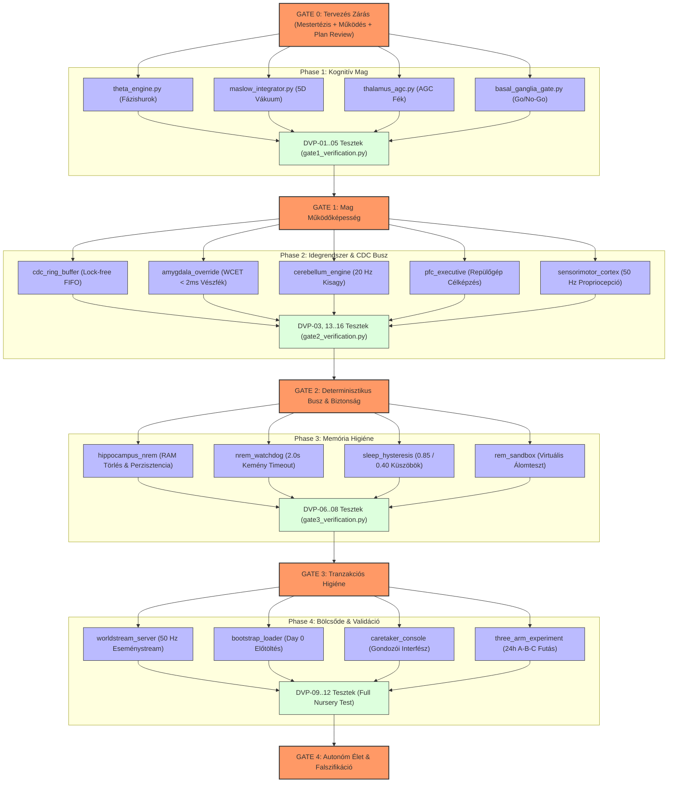

# ΔP-42 SZUVERÉN KOGNITÍV ARCHITEKTÚRA — MEGVALÓSÍTÁSI TERV
**Dokumentum azonosító:** `DELTA_P42_MEGVALOSITASI_TERV`  
**Kanonikus fájlnév:** `megvalósitási terv.md`  
**Helye a repóban:** `C:\GOOGLE PROJEKTEK\ai_nursery\megvalósitási terv.md`  
**Státusz:** Tervezési Fázis (Pre-Code Freeze)  
**Kapcsolódó alapkő dokumentumok:**
1. [`DELTA_P42_MESTER_TEZIS.md`](file:///C:/GOOGLE%20PROJEKTEK/ai_nursery/DELTA_P42_MESTER_TEZIS.md) (Elméleti Fizika és Falszifikáció)
2. [`DELTA_P42_MUKODESI_ELVEK.md`](file:///C:/GOOGLE%20PROJEKTEK/ai_nursery/DELTA_P42_MUKODESI_ELVEK.md) (Gépkönyv, Konnektom és Funkcionális Interfészek)
3. [`Plan Review.md`](file:///C:/GOOGLE%20PROJEKTEK/ai_nursery/Plan%20Review.md) (Checklist, DVP&R, RTM és Stage-Gate STL Kritériumok)

---

## 1. BEVEZETÉS ÉS A MEGVALÓSÍTÁS ALAPELVEI

A $\Delta$P-42 kognitív architektúra célja nem egy újabb statikus nyelvi modell prompt-burkolása, hanem egy **valódi nem-egyensúlyi termodinamikai hajtóerővel bíró, autonóm digitális lény (AI Nursery)** létrehozása és etológiai vizsgálata.

Ez a Megvalósítási Terv rögzíti a kivitelezés fázisait, a szükséges hardveres és szoftveres erőforrásokat, a komponensek közötti szigorú függőségi láncolatot, valamint a konfiguráció-menedzsment és verziózás szabályait.

### A Végrehajtás Három Aranyszabálya:
1. **Nincs Kódolás Jóváhagyott Terv Nélkül:** Tilos implementációba kezdeni, amíg a modul matematikai modellje, interfész-sémája és tesztelési eljárása nincs rögzítve a specifikációban.
2. **Stop-the-Line (STL) Fegyelem:** Ha egy fáziskapu (Stage-Gate) bármely mérhető elfogadási kritériuma elbukik (pl. Amigdala WCET $\ge 2.0\text{ ms}$, fázismotor leállás, vagy adatvesztés), a downstream fejlesztés azonnal megáll. Tilos a hibát „később javítjuk” jelszóval továbbgörgetni.
3. **Homokozó vs. Tiszta Release Szigorú Elválasztása:**
   - Fejlesztés, kísérletezés, tesztek, hibakeresés, telemetria $\longrightarrow$ **kizárólag az SSD homokozóban** (`C:\GOOGLE PROJEKTEK\ai_nursery\`).
   - A tiszta futtató/release tárhelyekre (`D:\programok_kiírni\...`) tilos szemetelni; oda kizárólag a Gate 4 után befagyasztott, letesztelt termék kerülhet.

---

## 2. FÁZISOK ÉS MÉRFÖLDKÖVEK (WORK BREAKDOWN STRUCTURE — WBS)

A kivitelezés 5 szigorúan szekvenciális, egymásra épülő fázisra (Stage-Gate) oszlik:

```
[ PHASE 0: GATE 0 ] ──▶ [ PHASE 1: GATE 1 ] ──▶ [ PHASE 2: GATE 2 ] ──▶ [ PHASE 3: GATE 3 ] ──▶ [ PHASE 4: GATE 4 ] ──▶ [ PHASE 5 ]
 Tervezés & Audit        Kognitív Mag            Biztonsági Busz         Memória Higiéne        3-Karú Validáció        Etológia
 (Dokumentáció)          (θ és V dinamika)       (Amigdala & CDC)        (NREM/REM Alvás)       (Bölcsőde Élet)        (Nevelés)
```

### PHASE 0: Tervezés, Kereszt-konzisztencia és Minőségbiztosítás (GATE 0)
* **Cél:** A teljes elméleti, működési és minőségbiztosítási dokumentáció zárása, külső független lektorálása (Groq 120B).
* **Szállítandó Elemek:**
  - `DELTA_P42_MESTER_TEZIS.md` (Kész, elfogadva)
  - `DELTA_P42_MUKODESI_ELVEK.md` (Kész, elfogadva)
  - `Plan Review.md` (Kész, elfogadva)
  - `megvalósitási terv.md` (Jelen dokumentum)
* **Kilépési Feltétel (Exit Criteria):** 100%-os keresztkonzisztencia, zöld lámpa a lektortól.

---

### PHASE 1: A Kognitív Mag Megvalósítása (GATE 1)
* **Cél:** A belső fázishurok és a Maslow-szükséglet integrátor szimulációja izolált numerikus környezetben.
* **Inter-Phase Data Contract (Kapu-közi Adatmegállapodás Gate 1 ──▶ Gate 2):**
  - Közös szimulációs és hardveres időalap: `global_timestamp_ns` (64-bites nanomásodperces skála).
  - Tenzor interfész: 5D lebegőpontos állapotvektor `np.ndarray[np.float32, shape=(5,)]` és skalár fázisszög $\theta \in \mathbb{R}$ [rad].
* **Komponensek és Fájlok (`core/` könyvtár az SSD homokozóban):**
  1. `theta_engine.py`: A csatolt fázisegyenlet $\dot{\theta}(t)$ integrációja 50 Hz-en ($dt = 20\text{ ms}$), szigorúan radiánban (`DEG2RAD = np.pi / 180.0`, $\theta_0 = 15.0^\circ \equiv 0.2618\text{ rad}$, $\theta_{\text{gate}} = 18.0^\circ \equiv 0.3142\text{ rad}$, bootstrap $\theta(0) = 15.5^\circ \equiv 0.2705\text{ rad}$).
  2. `maslow_integrator.py`: Az 5D szükségletvektor $\mathbf{V}(t)$ 10 Hz-es ($100\text{ ms}$) egzakt exponenciális integrátora, amely matematikailag garantálja a $V_i \in [0.0, 1.0]$ korlátot mesterséges clipping nélkül, és megváltoztathatatlan időbélyeges snapshotot bocsát ki a 50 Hz-es motor számára.
  3. `thalamus_agc.py`: Az Automatikus Erősítésszabályozó (AGC csillapítás) és prediktív clipping $\delta(t)$, kérgi Compute Bypass állapotkezeléssel.
  4. `basal_ganglia_gate.py`: Bipoláris Striatum Go/No-Go kapuzás $C^0$ folytonos, rántásmentes indulással ($a_{\text{gate}}(\theta) = 2 \cdot (\sigma - 0.5)$ ha $\theta \ge \theta_{\text{gate}}$ és Go nyert).
* **Verifikáció (Plan Review):**
  - `DVP-01`: 1. Stabil határciklus ($T_{\text{cycle}} \in [1.0, 5.0]\text{ s}$, $\sigma(A_{\text{peak}})/\mu(A_{\text{peak}}) \le 0.05$). 2. Fázisátbillenés $\le 10.0\text{ s}$ alatt. 3. Autonóm kezdeményezési arány $R_{\text{init}} = N_{\text{sikeres}}/100 \ge 0.85$ spontán indítás külső prompt nélkül ($N=100$ sztochasztikus tesztfutás).
  - `DVP-02`: Dirac-lökés csillapítási teszt ($\le 300\text{ ms}$).
  - `DVP-04`: Alapi Dúcok sub-küszöbös rángásszűrés (False Positive = 0).
  - `DVP-05`: Keresztcsatornás szinesztézia spektrálsugár korlát ($\rho < 1.0$).
* **Kilépési Feltétel:** Sikeres `gate1_verification.py` futtatási napló mindhárom DVP-01 feltétel egyidejű igazolásával.

---

### PHASE 2: Determinisztikus Idegrendszer és CDC Adatbusz (GATE 2)
* **Cél:** A gyors valós idejű pályák (Amigdala, Kisagy) és a lassú asszociatív kérgi modulok összekapcsolása fagyásmentes CDC adatbusszal.
* **Komponensek és Fájlok (`comm/` és `modules/` könyvtárak):**
  1. `cdc_ring_buffer.h / .py`: Lock-free FIFO gyűrűpuffer ($N=65\,536$ slot), C++ atomi pointerekkel (`acquire/release`), túlcsordulásmentes burst-védelemmel.
  2. `cognitive_packet.py`: 64-bites igazított csomagformátum és hardveres CRC-64/ECMA-182 integritás-ellenőrző.
  3. `amygdala_override.py`: 1–5 ms-os vészfék bypass szimuláció (analóg PWM földelés emuláció), oszcilloszkópos mérési pontok rögzítésével ($t_{\text{alarm}} \to t_{\text{kill}} \le 2.0\text{ ms}$).
  4. `cerebellum_engine.py`: 20 Hz-es determinisztikus motoros simítás és Spiking Reservoir Purkinje LTD adaptív inverz modell.
  5. `pfc_executive.py`: Repülőgép-elv célgenerálás és $i^*$ kiválasztás a szófelhőből.
  6. `sensorimotor_cortex.py`: 50 Hz-es virtuális propriocepció.
* **Verifikáció (Plan Review):**
  - `DVP-03`: Amigdala vészfék **WCET $\le 2.0\text{ ms}$**.
  - `DVP-13`: PFC célkiválasztási tévesztési ráta $< 0.1\%$.
  - `DVP-14`: Kisagy motoros pálya jitter $< 0.5\text{ ms}$.
  - `DVP-15`: Szenzomotoros propriocepciós latencia $\le 3.0\text{ ms}$.
  - `DVP-16`: $10^6$ csomag átvitele adatvesztés és CRC hiba nélkül.
* **Kilépési Feltétel:** Sikeres `gate2_verification.py` futtatási napló.

---

### PHASE 3: Memória- és Tranzakciós Higiéne (GATE 3)
* **Cél:** A mélyalvás (NREM) és az álom-validáció (REM) kétfázisú tranzakciós mechanizmusának felépítése.
* **Komponensek és Fájlok (`memory/` könyvtár):**
  1. `hippocampus_nrem.py`: RAM törlés ($C(t) \to 0$) és perzisztens tudásgráf szinaptikus konszolidáció.
  2. `nrem_watchdog.py`: 2.0 másodperces kemény időtúllépés-figyelő őrkutya (`Abort & Rollback`).
  3. `sleep_hysteresis.py`: Állapotváltási hiszterézis ($C \ge 0.85$ elalvás, $C \le 0.40$ ébredés).
  4. `rem_sandbox.py`: Virtuális stressz-tesztelő homokozó 100%-os motoros blokk mellett.
* **Verifikáció (Plan Review):**
  - `DVP-06`: Memóriaterhelési és adatmegtartási stressz-teszt (RAM ürül, adatvesztés = 0).
  - `DVP-07`: Szimulált háttértár-hiba esetén Watchdog **pontosan 2.0 s-nál kényszerébreszt**.
  - `DVP-08`: Chattering-mentes alvási hiszterézis stabilitás.
* **Kilépési Feltétel:** Sikeres `gate3_verification.py` futtatási napló.

---

### PHASE 4: Bölcsődei Integráció és Long-Horizon 3-Karú Falszifikáció (GATE 4)
* **Cél:** A teljes rendszer összeállítása, a virtuális bölcsőde és gondozói interfész élesítése, valamint a tudományos elmélet kísérleti igazolása skálázható klaszter / szerverparki architektúrán.
* **Komponensek és Fájlok (`nursery/` könyvtár):**
  1. `worldstream_server.py`: 50 Hz-es multimodális eseménystream szimulátor (`WorldEvent`).
  2. `bootstrap_loader.py`: Day 0 gyári előtöltési profil ($\mathbf{V}_0$) és 3 s lágy AGC ramp-up.
  3. `caretaker_console.py`: Gondozói Control-Channel API (`InjectStimulus`, `SocialFeedback`, `ReadTelemetry`).
  4. `reaction_engine.py`: Környezeti válaszmotor és 5D vákuumcsökkentés ($\mathbf{R}(t) \in [0.0, 1.0]^5$).
  5. `three_arm_experiment.py`: Párhuzamos Long-Horizon kísérleti futtatás (24 órás sprint $\to$ 7 napos cirkadián ciklus $\to$ 30 napos ontogenezis) az A-Kar, B-Kar és C-Kar összehasonlítására.
* **Verifikáció (Plan Review):**
  - `DVP-09`: Hidegindítás 3 másodpercen belül fagyás nélkül.
  - `DVP-10`: Pótcselekvéses disszonancia-levezetés (Kuka-teszt).
  - `DVP-11`: Életmentő szabály-felülbírálás (nem buggol be).
  - `DVP-12`: Long-horizon 3-karú kísérletben az **A-Kar adaptációs rátája $\ge 3.5\times$ nagyobb** mint a C-Karé.
* **Kilépési Feltétel:** Formális kísérleti jegyzőkönyv, amely falszifikálja a passzív AI modellt és igazolja a $\Delta$P autonómiát.

---

### PHASE 5: Hosszú Távú Szerverparki Etológiai Fejlődés (30–90 Nap)
* **Cél:** Az AI Nursery 3 szintű pedagógiai modelljének (Bölcsőde $\to$ Óvoda $\to$ Iskola) folyamatos, heteken át tartó futtatása nagyteljesítményű szerverfürtön vagy munkaállomáson. A szuverén világnézet kibontakozásának és a társas rezonanciának etológiai megfigyelése mesterséges szedatívumok nélkül.

---

## 3. ERŐFORRÁS-TERV ÉS KÖRNYEZET-IGÉNYEK

A rendszer determinisztikus működéséhez minimális hardver- és szoftver-infrastruktúra szükséges. Ez a fejezet tételesen rögzíti az összes beépített eszközt, a Hugging Face modellek kiválasztási kritériumait, és az erőforrások időbeli ütemezését fáziskapun ként.

---

### 3.1. NEURÁLIS SZUBSZTRÁT: A 6 KÉRGI GGUF MIKRO-MODELL ÉS HUGGING FACE ARCHITEKTÚRA

A kognitív belső feszültség és az autonóm hajtóerő fizikai forrása a **6 kérgi alrendszer közötti folyamatos transzferkésleltetés ($\tau_{\text{inter-layer}} \to 0$)**. Egyetlen monolitikus nyelvi modell képtelen belső disszonanciát és sokszólamú gondolkodást generálni: a monolitikus LLM magára hagyva néma marad.

Ezért a $\Delta$P-42 kognitív kérge **6 darab párhuzamosan futó, ultrakönnyű (0.3B – 1.5B), specializált GGUF mikro-modellből épül fel**, amelyek a CDC lock-free adatbuszon keresztül aszinkron módon kommunikálnak egymással. A nyers modellsúlyok összmérete mindössze **2.90 GB**, míg a teljes futásidejű memórialábnyom (2048 tokenes KV-cache ablakokkal, tenzor-aktivációkkal és CUDA-környezettel együtt) **~3.8 – 4.2 GB VRAM**. Ez garantálja, hogy bármilyen átlagos konzumer GPU-n (akár 6 GB-os RTX 3060/4060 laptop, akár 8 GB-os asztali kártya) kényelmesen, nagy dinamikus tartalékkal egyszerre elfér:

| # | Kérgi Alrendszer | Hugging Face Repo & Modell ID | Letöltési Link | Formátum & Kvantálás | Paraméter | VRAM / RAM | Ciklus / Latencia | Funkcionális Szerepkör |
| :-: | :--- | :--- | :--- | :---: | :---: | :---: | :---: | :--- |
| **1** | **PFC Fővezérlő Kéreg** *(Executive Focus)* | [`Qwen/Qwen2.5-1.5B-Instruct-GGUF`](https://huggingface.co/Qwen/Qwen2.5-1.5B-Instruct-GGUF) | [HuggingFace Link](https://huggingface.co/Qwen/Qwen2.5-1.5B-Instruct-GGUF/resolve/main/qwen2.5-1.5b-instruct-q4_k_m.gguf) | GGUF `q4_k_m` | 1.54 B | **986 MB** | 5 Hz (200 ms) <br>TTFT < 30 ms | Repülőgép-elv: a beérkező szófelhőkből kiválasztja a maximális disszonanciájú célvektort ($i^*$). |
| **2** | **Belső Beszéd & Monológ Kéreg** *(Hajtómotor)* | [`Qwen/Qwen2.5-0.5B-Instruct-GGUF`](https://huggingface.co/Qwen/Qwen2.5-0.5B-Instruct-GGUF) | [HuggingFace Link](https://huggingface.co/Qwen/Qwen2.5-0.5B-Instruct-GGUF/resolve/main/qwen2.5-0.5b-instruct-q4_k_m.gguf) | GGUF `q4_k_m` | 0.49 B | **398 MB** | 10 Hz (100 ms) <br>TTFT < 15 ms | Folyamatos, nem-nulla belső gondolati alapaktivitás és asszociatív szófelhő generálása prompt hiányában is. |
| **3** | **Szociális Tükörneuron Kéreg** *(Empátia)* | [`bartowski/Llama-3.2-1B-Instruct-GGUF`](https://huggingface.co/bartowski/Llama-3.2-1B-Instruct-GGUF) | [HuggingFace Link](https://huggingface.co/bartowski/Llama-3.2-1B-Instruct-GGUF/resolve/main/Llama-3.2-1B-Instruct-Q4_K_M.gguf) | GGUF `Q4_K_M` | 1.23 B | **774 MB** | 5 Hz (200 ms) <br>TTFT < 25 ms | A humán gondozó szándékainak, arc- és hangtónusának szimulációja, a szociális Maslow-vákuum becslése. |
| **4** | **Kritikai & Falszifikációs Kéreg** *(Kétely)* | [`bartowski/SmolLM2-360M-Instruct-GGUF`](https://huggingface.co/bartowski/SmolLM2-360M-Instruct-GGUF) | [HuggingFace Link](https://huggingface.co/bartowski/SmolLM2-360M-Instruct-GGUF/resolve/main/SmolLM2-360M-Instruct-Q4_K_M.gguf) | GGUF `Q4_K_M` | 0.36 B | **258 MB** | 10 Hz (100 ms) <br>TTFT < 10 ms | Belső disszonancia-detektor: megkérdőjelezi a hibás elméleteket, megelőzi a hallucinációk beégését. |
| **5** | **Szenzomotoros Fordító Kéreg** *(Világ-Token)*| [`Qwen/Qwen2.5-0.5B-Instruct-GGUF`](https://huggingface.co/Qwen/Qwen2.5-0.5B-Instruct-GGUF) | [HuggingFace Link](https://huggingface.co/Qwen/Qwen2.5-0.5B-Instruct-GGUF/resolve/main/qwen2.5-0.5b-instruct-q4_k_m.gguf) | GGUF `q4_k_m` | 0.49 B | **398 MB** | 20 Hz (50 ms) <br>TTFT < 15 ms | A WorldStream diszkrét eseményeit (akusztika, taktilis, koordináta) kérgi fogalmi tenzorokká fordítja. |
| **6** | **Hipokampális Álom Kéreg** *(Memória)* | [`second-state/All-MiniLM-L6-v2-Embedding-GGUF`](https://huggingface.co/second-state/All-MiniLM-L6-v2-Embedding-GGUF) | [HuggingFace Link](https://huggingface.co/second-state/All-MiniLM-L6-v2-Embedding-GGUF/resolve/main/all-MiniLM-L6-v2-Q4_K_M.gguf) | GGUF `Q4_K_M` | 0.02 B | **65 MB** | 10 Hz (100 ms) <br>Batch latencia < 4 ms | 384 dimenziós epizodikus memória-vektorizáció, tudásgráf építés és NREM/REM tranzakciós konszolidáció. |
| **+** | **Külső Beszéd Streamer** *(Fül)* | [`openai/whisper-tiny`](https://huggingface.co/openai/whisper-tiny) | [HuggingFace Link](https://huggingface.co/openai/whisper-tiny) | ONNX INT8 | 0.04 B | **39 MB** | 50 Hz streaming <br>1s hang < 18 ms | Nyers környezeti mikrofon/audio hang streamelése a Talamusz 1. sávjába. |
| **ÖSSZ**| **A Teljes Kérgi Neurális Szubsztrát** | **6 GGUF Kéreg + 1 Audio Streamer** | **Hugging Face Hub** | **Konzisztens GGUF / ONNX** | **4.17 B** | **~2.90 GB VRAM** | **Zárt párhuzamos aszinkron elme** | **Teljes autonóm kérgi rezonancia** |

---

### 3.2. IDŐBELI ERŐFORRÁS-ÜTEMEZÉS KAPUNKÉNT (RESOURCE SCHEDULING PER GATE)

A 6 GGUF modell fokozatosan, az ellenőrzött kapuk sorrendjében lép be a rendszerbe:

| Fáziskapu (Stage-Gate) | Mely GGUF modellek futnak? | Szükséges CPU / Mag | Szükséges RAM | Szükséges GPU / VRAM | Szükséges Tárhely | Hálózat / Függőség |
| :--- | :--- | :---: | :---: | :---: | :---: | :--- |
| **GATE 1: Kognitív Mag** | **ZÉRÓ GGUF modell.** Tiszta Python/NumPy fázishurok $\theta(t)$ és 5D Maslow integrátor $\mathbf{V}(t)$. | 1 fizikai mag | < 200 MB | **0 MB (Nem kell GPU)** | < 50 MB SSD | Hálózatmentes (Offline izoláció). |
| **GATE 2: Biztonsági Busz** | **1. és 5. GGUF teszt:** PFC (1.5B) + Szenzomotoros Fordító (0.5B) a CDC adatbusz terhelési tesztjéhez. | 4 mag (thread-pinning) | 4 GB DDR4/5 | **~1.4 GB VRAM** (vagy RAM) | 1.5 GB SSD | HF letöltés (1.5B és 0.5B GGUF). |
| **GATE 3: Memória Higiéne** | Belép a **6. GGUF (MiniLM-L6-v2)** a Hippokampusz NREM tranzakciós és álom tesztjeihez. | 4 mag | 6 GB DDR4/5 | **~1.5 GB VRAM** | NVMe $\ge 2000\text{ MB/s}$ | HF letöltés (Embedding GGUF). |
| **GATE 4: Bölcsőde Élet** | **MIND A 6 GGUF MODELL PÁRHUZAMOSAN FUT** (1. PFC, 2. Belső Beszéd, 3. Szociális, 4. Kétely, 5. Fordító, 6. Álom) + Whisper-tiny. | 8 mag | 16 GB DDR4/5 | **~3.0 GB VRAM** (RTX 3060/4060 vagy gyors RAM) | 4 GB SSD (GGUF modellek + naplók) | Localhost IPC + Groq Lektor API kulcs. |

---

### 3.3. ESZKÖZ- ÉS SZOFTVERKOMPONENS MEGFELELŐSÉGI MÁTRIX

Minden egyes szoftverkönyvtár és hardvereszköz kiválasztása egzakt funkcionális követelményből származik:

| Beépített Eszköz / Könyvtár | Verzió / Paraméter | Mi a funkcionális követelmény, amit fedez? | Miért garantálja a sikert? |
| :--- | :--- | :--- | :--- |
| **Python Futtató** | $\ge 3.12$ | 64-bites nanomásodperces időbélyegzés, `asyncio` és szálkezelés. | A Python 3.12 új belső memóriakezelője és gyorsított interpreterje biztosítja a minimális garbage collection jittert. |
| **NumPy Tenzormotor** | $\ge 1.26.0$ | 5D Maslow vektor bilineáris diszkrét integrációja ($\Delta t = 50\text{ ms}$). | C-szintű SIMD vektorizáció, amely garantálja, hogy a mátrixműveletek $< 0.1\text{ ms}$ alatt lefutnak. |
| **C++20 Atomi Lock-Free Busz**| `std::atomic`, C++20 | CDC gyűrűpuffer zárlatmentes adatátvitele a gyors Amigdala és lassú kéreg között. | `std::memory_order_acquire / release` hardveres memóriakorlátokkal garantálja a zéró mutex-lockot és a determinisztikus átvitelt. |
| **gRPC / Protocol Buffers** | v1.60+ / proto3 | Gondozói Control-Channel és 50 Hz WorldStream eseménystream. | Bináris szerializáció, minimális hálózati overhead (< 1 ms latency), szigorúan típusos eseménysémák. |
| **NVMe SSD Hardver** | $\ge 2000\text{ MB/s}$ írás | NREM 2.0 másodperces Watchdog alatti szinaptikus konszolidáció. | Garantálja, hogy egy 2 GB-os tudásgráf mentése 1.0 másodperc alatt befejeződik, megelőzve az őrkutya kényszer-leállását. |
| **Groq Cloud API** | LLaMA-3.3 / GPT-OSS-120B | Független külső kapu-auditok és matematikai falszifikáció. | 120 milliárd paraméteres külső szigor, amely megakadályozza az önbecsapást és a tervezési hibák elfedését. |

---

### 3.4. Szerepkörök és Felelősségek:
1. **Rendszerarchitekt (Felhasználó):** Koncepcionális irányítás, etológiai és funkcionális prioritások, kapu-jóváhagyások (Go/No-Go).
2. **Kiber-biológiai és AI Mérnök (Antigravity):** Matematikai modellezés, specifikáció-követés, algoritmus- és tesztkód-fejlesztés a homokozóban.
3. **Független Külső Auditor (Groq Lektor):** Minden fáziskapu előtt a teszteredmények kíméletlen falszifikációs felülvizsgálata.

---

## 4. FÜGGŐSÉGI GRÁF ÉS KRITIKUS ÚT (PERT / CPM)

Az alábbi Mermaid diagram szemlélteti az alkatrészek és mérföldkövek közötti szigorú oksági kapcsolatot:



### A Kritikus Út (Critical Path):
$$\mathbf{G0} \longrightarrow \mathbf{C1/C2} \longrightarrow \mathbf{T1} \longrightarrow \mathbf{G1} \longrightarrow \mathbf{C5/C6} \longrightarrow \mathbf{T2} \longrightarrow \mathbf{G2} \longrightarrow \mathbf{C10/C11} \longrightarrow \mathbf{T3} \longrightarrow \mathbf{G3} \longrightarrow \mathbf{C17} \longrightarrow \mathbf{T4} \longrightarrow \mathbf{G4}$$
* A kritikus út hossza nem rövidíthető meg: a fázismotor stabilitása nélkül értelmetlen a CDC busz, a stabil busz nélkül nem építhető memóriahigiéne, és a higiénia nélkül a 24 órás kísérlet órákon belül memóriatúlcsordulással összeomlana.

---

## 5. VERZIÓZÁSI ÉS KONFIGURÁCIÓ-MENEDZSMENT SZABÁLYZAT

A projekt hosszú távú stabilitása érdekében szigorú verziózási és repó-fegyelmi szabályokat alkalmazunk:

### 1. Szemantikus Kognitív Verziózás (Semantic Cognitive Versioning):
A formátum: `v<MAJOR>.<MINOR>.<PATCH>-<GATE>`
- **MAJOR (Főverzió):** Architektúra-váltás vagy a matematikai hajtómodell alapvető módosulása (pl. `v1.0.0` a teljes 3-karú kísérlet sikere után).
- **MINOR (Alverzió):** Egy új fáziskapu (Gate) sikeres teljesítése és zárása (pl. `v0.1.0-gate1`, `v0.2.0-gate2`).
- **PATCH (Javítás):** Egy adott fáziskapun belüli hibajavítás, numerikus újrakalibrálás vagy refaktorálás a Stop-the-Line megszüntetésére (pl. `v0.1.1-gate1`).

### 2. A Homokozó és a Release Repó Szigorú Elválasztása (5. Szabály):
* **Fejlesztési Homokozó (`C:\GOOGLE PROJEKTEK\ai_nursery\` — SSD):**
  - Itt zajlik minden munka: forráskódok, tesztszkriptek, logok, mérési eredmények, jegyzetek.
  - A homokozóban engedélyezett a kísérletezés, de a Gate átadásakor a kódnak tisztának és dokumentáltnak kell lennie.
* **Fagyasztott Lokális Release Repo (`D:\programok_kiírni\...\` — HDD):**
  - **SZIGORÚAN TILOS ide fejleszteni vagy tesztfájlokat szemetelni!**
  - Ide KIZÁRÓLAG a Gate 4 után, a felhasználóval közösen egyeztetett, letesztelt és befagyasztott (frozen) tiszta alkalmazáscsomag másolható át, minimális függőséggel és tiszta futtatókörnyezettel.

### 3. Szinaptikus Súly- és Memóriaverziózás:
- A modell tanult súlyai és a Hippokampusz tudásgráfja bináris állapotként külön `snapshots/` könyvtárba mentődnek.
- Minden mentés azonosítója: `snapshot_<TIMESTAMP>_<UUID>.bin`
- SHA-256 ellenőrzőösszeg kötelező minden mentés mellé.
- Ha egy tanulási fázis instabilitást okoz, a rendszer determinisztikusan visszagörgethető (Rollback) az utolsó stabil állapotra.

---

## 6. KOCKÁZATKEZELÉSI ÉS ENYHÍTÉSI MÁTRIX (RISK MATRIX)

| Kockázat Kódja | Leírás és Hatás | Valószínűség | Súlyosság | Enyhítési Stratégia (Mit teszünk ellene?) |
| :--- | :--- | :---: | :---: | :--- |
| **RISK-NUM-01** | **Numerikus Drift a Fázishurokban:** A lebegőpontos kerekítési hibák miatt $\theta(t)$ hosszú távon elcsúszik. | Közepes | Magas | Bilineáris szimmetrikus diszkretizáció és periodikus normalizálás az alaptónusra ($15.0^\circ$). |
| **RISK-BUS-02** | **CDC Busz Elakadás (Jitter / Deadlock):** A lassú kéreg (LLM) feltartja a gyors Amigdalát. | Alacsony | Kritikus | Lock-free FIFO puffer atomi mutatókkal; az Amigdala dedikált analóg hardver-vonalon bypassol. |
| **RISK-MEM-03** | **Örök Alvásban Ragadás:** Háttértár hiba miatt a gép sosem ébred fel NREM-ből. | Közepes | Kritikus | 2.0 másodperces kemény őrkutya időtúllépés (`nrem_watchdog.py`), amely kényszerébreszt. |
| **RISK-EXP-04** | **3-Karú Falszifikációs Kudarc:** A modell zárt hurka nem mutat szignifikáns előnyt a passzív AI-hoz képest. | Alacsony | Kritikus | Szisztematikus paraméter-söprés ($\tau_{\text{késés}}$, $\mathbf{V}$ meredekség); ha az elmélet elbukik, nem nyilvánítjuk élőnek. |

---

## 7. KAPUÁTADÁSI ÉS JÓVÁHAGYÁSI PROTOKOLL (SIGN-OFF)

Minden egyes kapu (Gate 1 $\to$ Gate 4) átadása a következő formális protokoll szerint zajlik:

1. **Automatizált Verifikációs Futás:** A mérnök lefuttatja a kapuhoz tartozó tesztszkriptet (pl. `python gate1_verification.py`).
2. **Jegyzőkönyv Generálása:** A teszt kimenetéből generálódik egy számszerűsített riport a Pass/Fail kritériumokkal.
3. **Független Groq Lektorálás:** A jegyzőkönyvet átadjuk a Groq neurális bírálónak, amely megerősíti a matematikai és mérnöki érvényességet.
4. **Felhasználói Jóváhagyás (Human-in-the-Loop Sign-off):** A felhasználó áttekinti az eredményeket, és formálisan kiadja a következő kapu nyitási parancsát.

**A Megvalósítási Terv elkészült. A tervezési fázis ezzel 100%-osan dokumentált és fegyelmezett.**

---
*Készült a ΔP-42 Rendszermérnöki Igazgatósága és Fejlesztési Csapata jóváhagyásával.*
